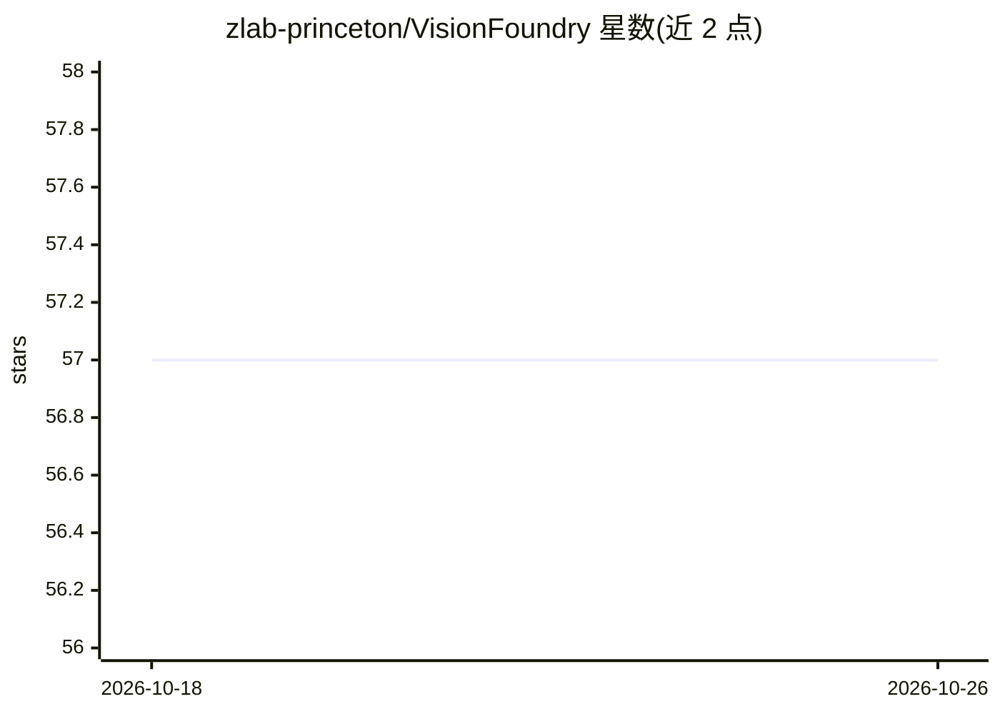

# zlab-princeton/VisionFoundry

⭐ 57 · Python · Apache-2.0 · 推送 2026-09-08 · [GitHub](https://github.com/zlab-princeton/VisionFoundry) · [官网](https://zlab-princeton.github.io/VisionFoundry) · 组织维护

**用合成图像教 VLM 视觉感知：数据生成+SFT/GRPO 训练配方**

面向 VLM 研究者的合成数据生成与训练流水线：输入一个任务关键词，通过 OpenAI 与 Gemini API 生成合成 VQA 数据与图像，输出 ms-swift 格式的 annotations.json。训练侧基于 ms-swift 提供 Qwen2.5-VL/MiMo-VL/Llama-3.2-Vision 三个骨干的 SFT 脚本，基于 verl 提供全参数 GRPO 配方与文本判据奖励；评测依赖 VLMEvalKit。生成需配置 OPENAI_API_KEY 与 GEMINI_API_KEY，训练脚本面向 8-GPU 单机或 Slurm 集群。Apache-2.0 许可。

## 筛选速览

| 维度 | 判定 | 备注 |
|---|---|---|
| AI 角色 | `ai-ecosystem` | LLM/agent 周边工具 |
| 许可风险 | `permissive` | Apache-2.0 |
| 部署形态 | `library` | 以包/库形式分发 |
| 模型依赖 | — | README 未给出锁定关系 |
| 硬件要求 | — | 无带数字的原话,不猜 |
| 安装摩擦 | `low` | 无编译、无系统依赖或容器化 |
| 成熟度 | — | 结构信号不足 |

## 能力要点

- 单关键词驱动 OpenAI/Gemini API 生成合成 VQA 数据与图像
- 提供 Qwen2.5-VL/MiMo-VL/Llama-3.2-Vision 的 SFT 与 GRPO 训练脚本
- verl 文本判据二值语义奖励，仅经环境变量配置
- HuggingFace 发布 VisionFoundry-10K 数据集

## 适用场景

- 为特定视觉感知任务自动生成合成训练数据
- 在 8-GPU 机器或 Slurm 集群上微调 VLM
- 用 GRPO 强化学习继续训练视觉模型并用 VLMEvalKit 评测

## 场景标签

`多模态` `微调` `强化学习` · 领域:感知与多模态

## 证据(README 行号)

> L39: The VisionFoundry pipeline is implemented in `data_engine/vision_foundry.py`. It generates synthetic VQA data and i
> L122: We provide both supervised fine-tuning and reinforcement-learning recipes.
> L179: The `rl/` directory provides full-parameter GRPO recipes for the same three backbones:

## 星数曲线

2026-10-18 57 → 2026-10-26 57（+0）

---
*卡片 v1 · prompt 1.4 · 生成 2026-10-24 · 置信度 mid · 依据 README sha `766b08c519d0` · [字段定义](../../DATASET.md)*
