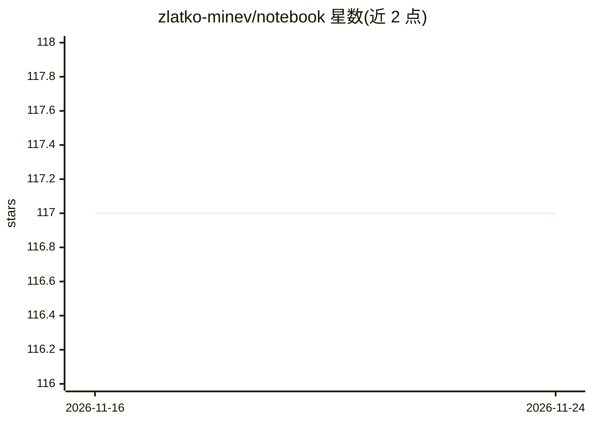

# zlatko-minev/notebook

⭐ 117 · Python · NOASSERTION · 推送 2026-11-16 · [GitHub](https://github.com/zlatko-minev/notebook) · [官网](https://www.zlatko-minev.com/notebook/) · 个人维护

**量子计算研究者的演讲/讲义/技术笔记个人归档（2011 至今）**

Zlatko Minev 的公开研究演讲、教学讲义与技术笔记策展归档，内容覆盖量子纠错缓解、超导硬件、多体物理与拓扑计算等，面向研究者、学生与爱好者。提供网站浏览（搜索、按主题/年份/层级过滤），每个讲义带引用页与 BibTeX；以 catalog.json 机器可读索引所有条目，附带 Python 工具链做 PDF 压缩、目录生成、缩略图与站点构建，内容按 CC BY-NC-ND 4.0 非商业共享。

## 筛选速览

| 维度 | 判定 | 备注 |
|---|---|---|
| AI 角色 | `ai-knowledge` | 知识聚合/清单类 |
| 许可风险 | `none` | NOASSERTION |
| 部署形态 | `None` |  |
| 模型依赖 | — | README 未给出锁定关系 |
| 硬件要求 | — | 无带数字的原话,不猜 |
| 安装摩擦 | `low` | 无编译、无系统依赖或容器化 |
| 成熟度 | — | 结构信号不足 |

## 能力要点

- 三类内容组织：研究演讲、教学讲义、技术笔记
- catalog.json 机器可读目录（标题/年份/会议/类别/标签）
- 每个讲义带引用页、Google Scholar 元数据与 BibTeX
- Python 工具链支持新增讲义、压缩 PDF 与重建站点

## 适用场景

- 查找量子计算/量子物理领域的讲座与讲义材料
- 按主题、年份、难度层级检索教学资源
- 引用讲义时获取规范 BibTeX

## 场景标签

`教程课程` · 领域:学习与行业

## 证据(README 行号)

> L13: A curated archive of public research talks, educational lectures, tutorials, and technical notes by Zlatko K. Minev
> L19: * **Research Talks**: Keynotes, conference talks, seminars, and invited colloquia on quantum error mitigation, supe
> L21: * **Technical Notes**: Concise derivations, foundational calculations, and working research notes prepared for inte

## 星数曲线

2026-11-16 117 → 2026-11-24 117（+0）

---
*卡片 v1 · prompt 1.4 · 生成 2026-11-17 · 置信度 high · 依据 README sha `cc6e8a637594` · [字段定义](../../DATASET.md)*
