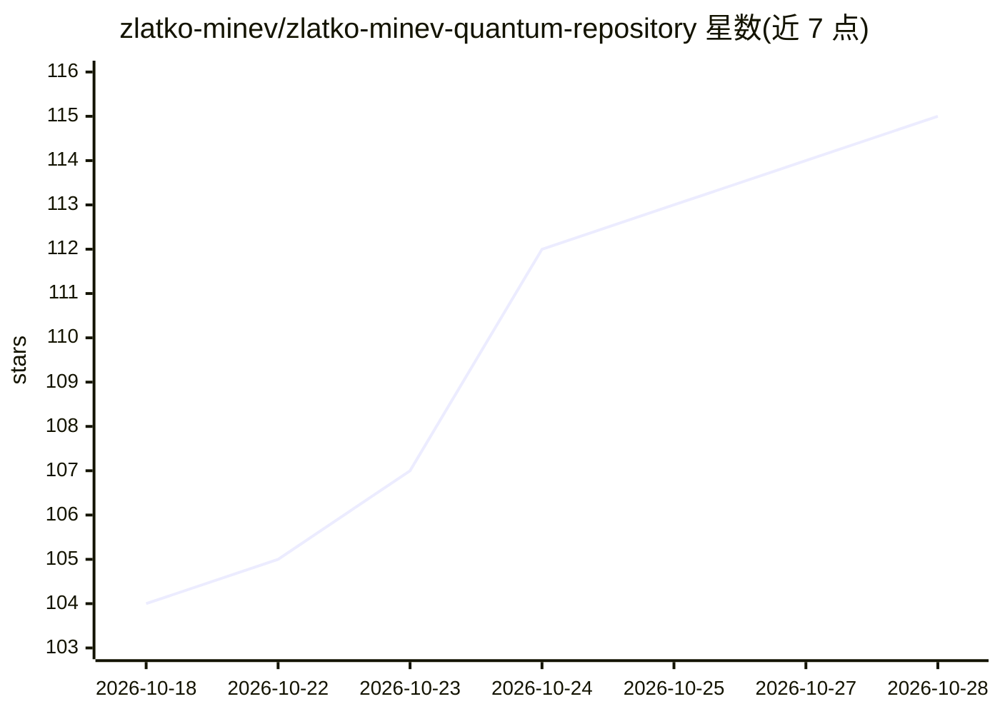

# zlatko-minev/zlatko-minev-quantum-repository

⭐ 115 · Python · NOASSERTION · 推送 2026-10-10 · [GitHub](https://github.com/zlatko-minev/zlatko-minev-quantum-repository) · [官网](https://zlatko-minev.github.io/zlatko-minev-quantum-repository/) · 个人维护

**个人量子计算研究讲稿与教程归档库（2011 至今）**

由 Zlatko K. Minev 维护的公开学术资料归档：收录其 2011 年至今的研究报告、教学讲座与技术笔记，主题涵盖量子纠错、超导硬件、多体物理与拓扑计算。通过 GitHub Pages 网站提供检索、按主题/年份/层级过滤，每个讲稿有独立页面、Google Scholar 元数据与 BibTeX。维护流程含 Python 脚本（PDF 压缩、目录生成、缩略图），内容以 catalog.json 索引，采用 CC BY-NC-ND 4.0 许可。

## 筛选速览

| 维度 | 判定 | 备注 |
|---|---|---|
| AI 角色 | `ai-knowledge` | 知识聚合/清单类 |
| 许可风险 | `none` | NOASSERTION |
| 部署形态 | `None` |  |
| 模型依赖 | — | README 未给出锁定关系 |
| 硬件要求 | — | 无带数字的原话,不猜 |
| 安装摩擦 | `low` | 无编译、无系统依赖或容器化 |
| 成熟度 | — | 结构信号不足 |

## 能力要点

- 研究讲稿、教学讲座、技术笔记三类内容归档
- 网站支持搜索过滤，每项含引文页与 BibTeX
- catalog.json 机器可读索引（标题/年份/ venue/标签）
- Python 工具链维护（add_deck/process_pdfs/build_catalog）

## 适用场景

- 查找量子计算与量子硬件领域的讲座讲稿
- 引用某报告时获取其 BibTeX 引用信息
- 按主题与年份浏览量子物理教学材料

## 场景标签

`教程课程` · 领域:学习与行业

## 证据(README 行号)

> L13: A curated archive of public research talks, educational lectures, tutorials, and technical notes by Zlatko K. Minev
> L19: * **Research Talks**: Keynotes, conference talks, seminars, and invited colloquia on quantum error mitigation, supe

## 星数曲线

2026-10-18 104 → 2026-10-28 115（+11）

---
*卡片 v1 · prompt 1.4 · 生成 2026-10-23 · 置信度 high · 依据 README sha `475a953af92c` · [字段定义](../../DATASET.md)*
