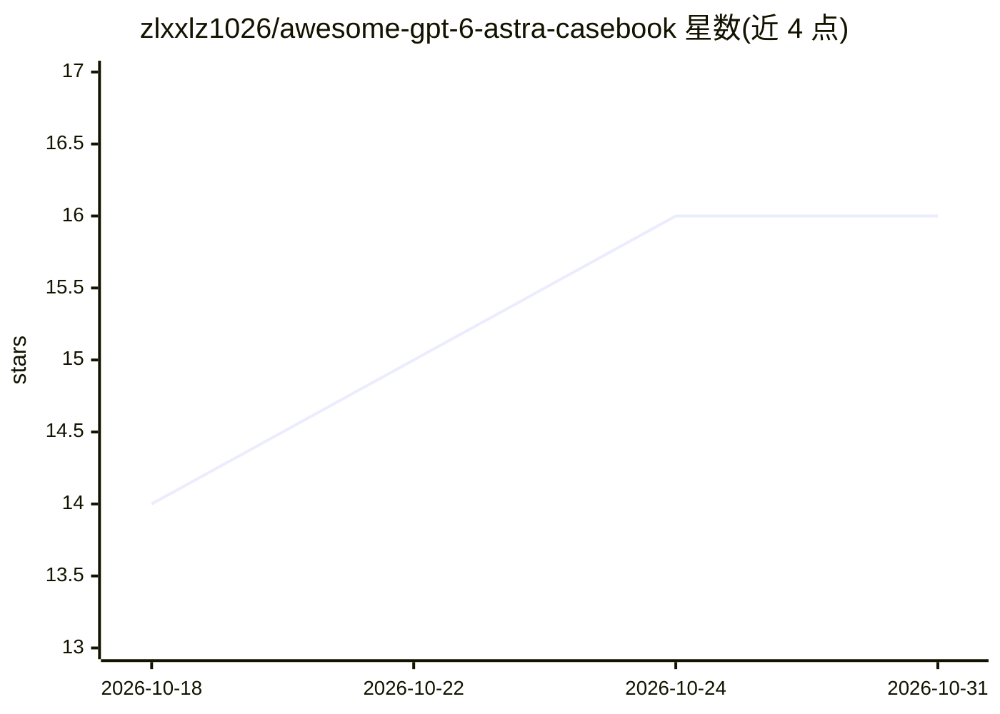

# zlxxlz1026/awesome-gpt-6-astra-casebook

⭐ 16 · Python · MIT · 推送 2026-09-21 · [GitHub](https://github.com/zlxxlz1026/awesome-gpt-6-astra-casebook) · 个人维护 · 中文 README

**GPT-6 Astra 实战案例与提示词策展清单（61 例，7 类）**

社区维护的 GPT-6 Astra 用例合集：收录 61 个案例，按应用与网站、设计创意、3D 空间创作、视频叙事、计算机使用与自动化、工程原型、游戏模拟 7 类组织。每条案例链接创作者公开成果、提示词（完整或摘录）、工具与工作流说明；中英双语，非官方项目也非基准测试。条目中工具名描述的是被收录作品所用工具，不构成必需集成清单；引用的提示词与预览版权归创作者，仓库 MIT 许可仅覆盖原创代码与文字。

## 筛选速览

| 维度 | 判定 | 备注 |
|---|---|---|
| AI 角色 | `ai-knowledge` | 知识聚合/清单类 |
| 许可风险 | `permissive` | MIT |
| 部署形态 | `None` |  |
| 模型依赖 | — | README 未给出锁定关系 |
| 硬件要求 | — | 无带数字的原话,不猜 |
| 安装摩擦 | `low` | 无编译、无系统依赖或容器化 |
| 成熟度 | — | 结构信号不足 |

## 能力要点

- 61 个案例按 7 个类别组织，附完整或摘录提示词
- 每条案例链接创作者原帖、工具与工作流说明
- 提供 4 篇案例分解（目标、约束、交付与验收分析）
- 中英双语，社区可通过 issue/PR 提交案例

## 适用场景

- 查找某类创作（如 3D、游戏、视频）的 GPT-6 Astra 提示词范例
- 学习如何把视觉简报、交付约束写进提示词
- 了解社区用 GPT-6 Astra 做出的作品与工作流

## 场景标签

`精选清单` `提示工程` · 领域:Agent 开发

## 证据(README 行号)

> L7: **61 cases · 7 categories**
> L9: Explore GPT-6 Astra use cases, prompt examples and community demos for app and website development, UI design, 3D cr
> L203: No. Awesome GPT-6 Astra is an independent community collection. Model attribution follows the recorded source evid

## 星数曲线

2026-10-18 14 → 2026-10-31 16（+2）

---
*卡片 v1 · prompt 1.4 · 生成 2026-10-30 · 置信度 high · 依据 README sha `ee80494c1ceb` · [字段定义](../../DATASET.md)*
