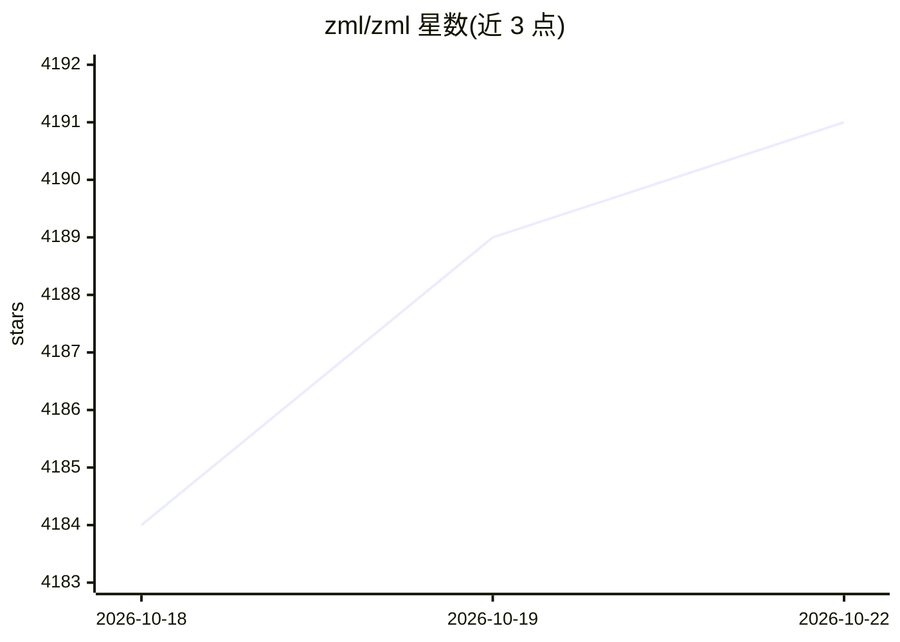

# zml/zml

⭐ 4,195 · Zig · Apache-2.0 · 推送 2026-10-22 · [GitHub](https://github.com/zml/zml) · [官网](https://zml.ai) · 组织维护

**跨硬件 AI 推理编译栈：一份代码编译到 NVIDIA/AMD/Intel/TPU/Trainium**

用 Zig 语言、MLIR 与 Bazel 构建的生产推理栈，将 AI 工作负载编译到 NVIDIA CUDA、AMD ROCm、Intel OneAPI、Google TPU 与 AWS Trainium/Inferentia 2 等加速器，无需改写代码。通过 bazel 构建与运行，提供 LLM CLI（支持 Llama 3.1/3.2、Qwen、LFM）、MNIST、分片、IO 与基准测试示例；模型可从 Hugging Face、本地目录或 S3 加载。构建唯一前置依赖是 bazel，源码方式安装运行，Apache 2.0 许可。

## 筛选速览

| 维度 | 判定 | 备注 |
|---|---|---|
| AI 角色 | `ai-ecosystem` | LLM/agent 周边工具 |
| 许可风险 | `permissive` | Apache-2.0 |
| 部署形态 | `None` |  |
| 模型依赖 | — | README 未给出锁定关系 |
| 硬件要求 | — | 无带数字的原话,不猜 |
| 安装摩擦 | `medium` | 含编译或系统依赖之一 |
| 成熟度 | — | 结构信号不足 |

## 能力要点

- 一份代码编译到 NVIDIA/AMD/Intel/TPU/Trainium 多种加速器
- 统一 LLM CLI，支持从 hf://、本地目录、S3 加载模型
- 逻辑网格、切分与分片本地执行的 sharding 示例
- 基于 Zig/MLIR/Bazel 构建，唯一前置依赖为 bazel

## 适用场景

- 在多种加速器硬件上部署同一模型而无需改写代码
- 通过 CLI 直接运行 Llama/Qwen 等开源 LLM 推理
- 测量模型加载与执行性能，探索张量切分部署

## 场景标签

`推理引擎` · 领域:训练与推理

## 证据(README 行号)

> L9: ZML is a production inference stack, purpose-built to decouple AI workloads from proprietary hardware.
> L13: Compiled directly to NVIDIA, AMD, INTEL, TPU, Trainium for peak hardware performance on any accelerator. No rewriti
> L83: ## Running Models on GPU / TPU

## 星数曲线

2026-10-18 4,184 → 2026-10-22 4,191（+7）

---
*卡片 v1 · prompt 1.4 · 生成 2026-10-20 · 置信度 high · 依据 README sha `46051c1f7983` · [字段定义](../../DATASET.md)*
