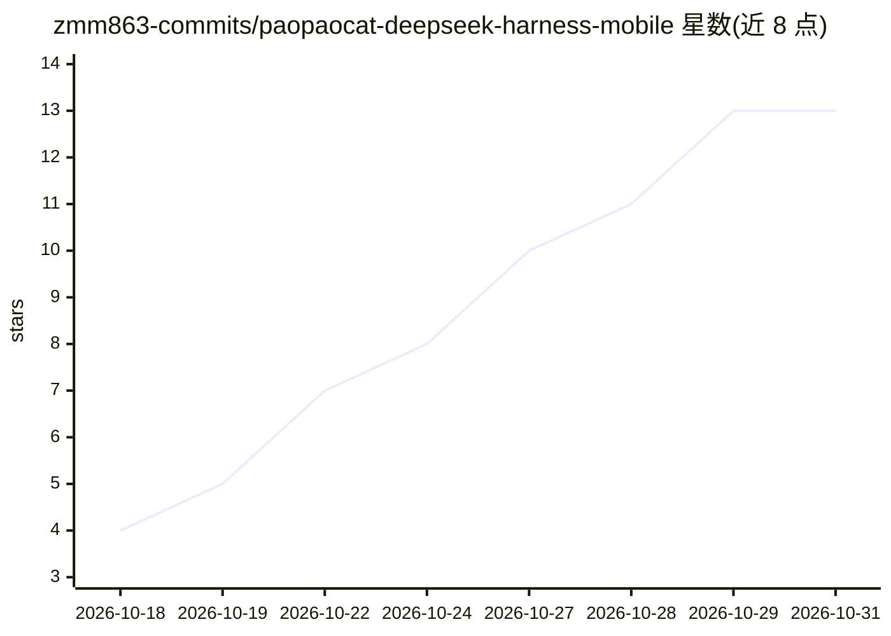

# zmm863-commits/paopaocat-deepseek-harness-mobile

⭐ 13 · MIT · 推送 2026-10-30 · [GitHub](https://github.com/zmm863-commits/paopaocat-deepseek-harness-mobile) · [官网](https://github.com/zmm863-commits/paopaocat-deepseek-harness-mobile/releases/latest) · 个人维护 · 中文 README

**把 DeepSeek Harness 智能体运行时完整装入 Android 手机的 App**

基于 Flutter + Node 的 Android 应用，将整套 DeepSeek Harness（DSH）Agent 运行时（含 libnode.so 与运行时包，合计约 80 MB）内嵌进 APK，首次启动解压到私有目录后可离线运行，仅与模型对话时联网。面向终端用户：配置 DeepSeek 等模型端点后，通过会话生成 PPT/Word/Excel/图片/视频等真实文件，内置 321 名专家、22 分区、23 个技能，支持定时任务、附件读取与多工作区。限制：仅 arm64-v8a 单架构，后台任务受国产 ROM 省电策略影响，插件安装未开放。

## 筛选速览

| 维度 | 判定 | 备注 |
|---|---|---|
| AI 角色 | `ai-native` | 本体是模型或模型工具 |
| 许可风险 | `permissive` | MIT |
| 部署形态 | `None` |  |
| 模型依赖 | locked-api |  |
| 硬件要求 | — | 无带数字的原话,不猜 |
| 安装摩擦 | `low` | 无编译、无系统依赖或容器化 |
| 成熟度 | `idea` | |

## 能力要点

- 内嵌 Node 运行时与全部依赖，除模型调用外完全离线
- 23 个技能覆盖生图、生视频、幻灯片、表格、数据分析等文件产出
- 321 名专家 / 22 分区，专家开关真写运行时配置
- API Key 存 Android Keystore，执行前需用户确认

## 适用场景

- 在手机上通过对话生成 PPT、Word、Excel 等真实文件
- 离线保存会话历史与产出文件，不依赖服务器
- 设置每天/每周定时任务自动产出文件

## 场景标签

`AI 助手` · 领域:对话与助手

## 证据(README 行号)

> L9: DSH 是一套能在本机跑起来的 AI Agent 运行时，能读写文件、执行任务、调用工具、维护多轮上下文。
> L11: 这个 App 做的是：**把一整套 DSH 运行时原封不动塞进 Android 应用**——内嵌 Node 运行时与全部依赖（`libnode.so` 约 47 MB + `dsh-runtime.zip` 约 33 MB），首次
> L34: 1. **配模型**：设置 → 选 DeepSeek 官方 / Command / LongCat / MiMo（端点已预填）→ 填 Key → **获取模型** → 勾选 → **测试并保存**（会真打一次最小对话，通了才显示已

## 星数曲线

2026-10-18 4 → 2026-10-31 13（+9）

---
*卡片 v1 · prompt 1.4 · 生成 2026-10-31 · 置信度 high · 依据 README sha `62865f67c241` · [字段定义](../../DATASET.md)*
