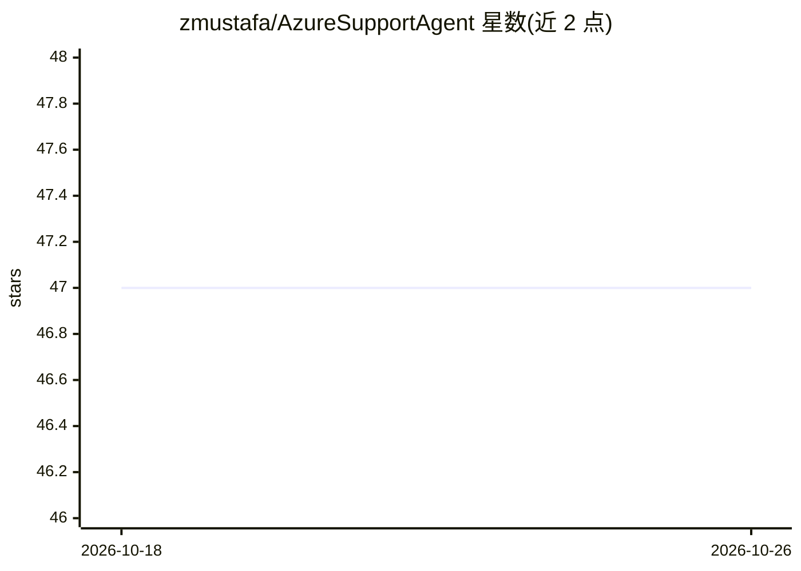

# zmustafa/AzureSupportAgent

⭐ 47 · Python · MIT · 推送 2026-10-24 · [GitHub](https://github.com/zmustafa/AzureSupportAgent) · [官网](https://github.com/zmustafa/AzureSupportAgent) · 个人维护

**面向 Azure 运维的 AI 工作台：租户对话、多智能体调查与治理**

部署在用户自己 Azure 订阅中的 AI 运维工作台，面向云架构师、SRE、平台团队与 Azure 支持工程师。通过官方 Azure MCP 服务器与 Microsoft Graph MCP 服务器读取租户数据，提供多会话聊天、由专项智能体（网络/身份/计算/安全等）并行调查的 War Room、架构逆向工程、Well-Architected 评估、Entra ID 十标签身份工作台、IAM 访问审查、备份与告警管理等功能。默认 Azure 访问只读，写操作需审批并审计；支持十余种自带 AI 提供商，未配置前保持禁用。一键部署到 Azure Container Apps。

## 筛选速览

| 维度 | 判定 | 备注 |
|---|---|---|
| AI 角色 | `ai-native` | 本体是模型或模型工具 |
| 许可风险 | `permissive` | MIT |
| 部署形态 | `None` |  |
| 模型依赖 | local-ok | 支持本地模型 |
| 硬件要求 | — | 无带数字的原话,不猜 |
| 安装摩擦 | `low` | 无编译、无系统依赖或容器化 |
| 成熟度 | — | 结构信号不足 |

## 能力要点

- War Room 多专项智能体并行调查并收敛结论
- 通过官方 Azure MCP 与 Microsoft Graph MCP 服务器读取租户实时数据
- 默认只读访问，写操作审批门控+审计
- 十余种自带 AI 提供商运行时可切换，未配置前禁用

## 适用场景

- 与 AI 对话排查 Azure 故障并获得有据可查的结论
- 对租户做 Well-Architected 式评估与治理审查
- 持续监控资产风险并通过 Teams/Jira/PagerDuty 等接收通知

## 场景标签

`多智能体` · 领域:Agent 开发

## 证据(README 行号)

> L3: **An AI-driven Azure operations workbench that runs in _your_ subscription.** Point it at
> L30: in the driver's seat** — it talks to your subscription through the official **Azure MCP
> L38: - 🧠 **Agentic, not just a chatbot** — a War Room of specialist agents investigates in parallel against your real Az

## 星数曲线

2026-10-18 47 → 2026-10-26 47（+0）

---
*卡片 v1 · prompt 1.4 · 生成 2026-10-25 · 置信度 high · 依据 README sha `9e1d04b69926` · [字段定义](../../DATASET.md)*
