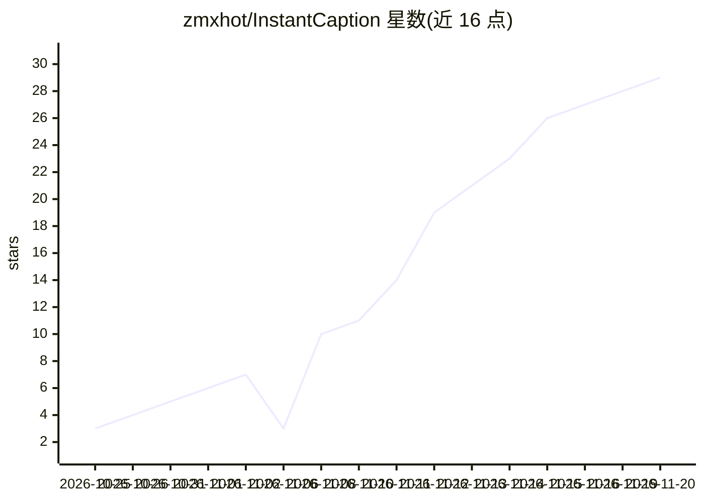

# zmxhot/InstantCaption

⭐ 29 · Java · Apache-2.0 · 推送 2026-10-19 · [GitHub](https://github.com/zmxhot/InstantCaption) · [官网](https://github.com/zmxhot/InstantCaption/releases/tag/v1.20.1-beta.1) · 个人维护 · 中文 README

**Android 离线 AI 同声传译应用：本地大模型实时翻译字幕**

面向 Android 用户的免费开源同声传译应用：识别手机麦克风或设备音频中的语音，经本地模型在设备上离线完成语音识别与翻译，以实时字幕和悬浮字幕形式输出翻译文本。文本翻译可用 HY-MT2-1.8B 等 LLM 或 OPUS-MT 路线（约 1.13 GB，建议 6 GB+ 内存）；源码集成高通 QNN/GenieX 与 LiteRT-LM NPU 后端（含 Qwen3、Gemma NPU 导出），公开 APK 目前使用 CPU 便携模型。支持 ARM64 Android 10+，应用内一次性下载模型后无需联网、账号或订阅，不产出译制语音。模型与厂商库有独立许可，分发 NPU 构建需先核查分发状态。

## 筛选速览

| 维度 | 判定 | 备注 |
|---|---|---|
| AI 角色 | `ai-native` | 本体是模型或模型工具 |
| 许可风险 | `permissive` | Apache-2.0 |
| 部署形态 | `None` |  |
| 模型依赖 | — | README 未给出锁定关系 |
| 硬件要求 | — | 无带数字的原话,不猜 |
| 安装摩擦 | `low` | 无编译、无系统依赖或容器化 |
| 成熟度 | `idea` | |

## 能力要点

- 语音识别与翻译全程在设备本地离线运行，无需云 API 或账号
- 悬浮字幕面板：可拖拽贴边、调节字号/透明度，主屏可独立显示原文
- 源码集成 Qualcomm QNN/GenieX 与 LiteRT-LM NPU 后端，支持 Qwen3/Gemma NPU 导出
- 语音与文本模型独立管理：下载、切换、删除、导入，推荐按处理器/Android 版本/RAM 生成

## 适用场景

- 看外语视频时叠加实时翻译的悬浮字幕
- 在无网络或不愿上云的场景下做面对面口语翻译
- 语言学习时同时查看原文与译文

## 场景标签

`语音识别` · 领域:感知与多模态

## 证据(README 行号)

> L5: **Instant Caption (瞬译) is a free, open-source AI simultaneous interpretation app for Android: real-time speech trans
> L16: - **Local large language models:** use HY-MT2-1.8B for direct multilingual CPU translation, or smaller OPUS-MT rout

## 星数曲线

2026-10-25 3 → 2026-11-20 29（+26）

---
*卡片 v1 · prompt 1.4 · 生成 2026-11-18 · 置信度 high · 依据 README sha `bc595a06580d` · [字段定义](../../DATASET.md)*
