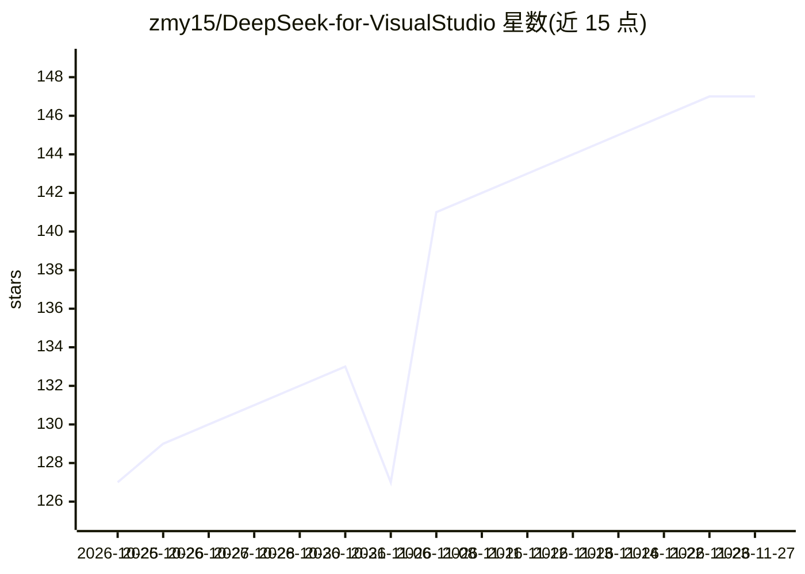

# zmy15/DeepSeek-for-VisualStudio

⭐ 147 · C# · MIT · 推送 2026-11-26 · [GitHub](https://github.com/zmy15/DeepSeek-for-VisualStudio) · [官网](https://marketplace.visualstudio.com/items?itemName=zmy15.DS4-VS) · 个人维护 · 中文 README

**Visual Studio 内的 DeepSeek 编码助手：聊天、补全与五类自主 agent**

以 VSIX 扩展形式集成到 Visual Studio 2022/2026 的编码助手：提供流式聊天（Markdown/KaTeX/Mermaid 渲染、思考过程块、AI 生成会话标题）、FIM 端点的 ghost-text 内联补全，以及 Ask/Explore/Plan/Edit/Build 五个 agent 组成的多 agent 系统（30 个内置工具加 MCP 工具）。编辑以逐 hunk diff 呈现供确认，配合 AllowAll/SmartBlock/BlockAll 三档审批模型控制写入操作。默认接 DeepSeek 官方 API，也可配置任意 OpenAI 兼容端点；需要 Windows 10/11 x64 与 .NET Framework 4.7.2，不支持 VS for Mac 与 VS Code。

## 筛选速览

| 维度 | 判定 | 备注 |
|---|---|---|
| AI 角色 | `ai-native` | 本体是模型或模型工具 |
| 许可风险 | `permissive` | MIT |
| 部署形态 | `desktop` | 安装包/桌面程序 |
| 模型依赖 | locked-api |  |
| 硬件要求 | — | 无带数字的原话,不猜 |
| 安装摩擦 | `high` | 编译与系统依赖俱全 |
| 成熟度 | — | 结构信号不足 |

## 能力要点

- 五个专职 agent（Ask/Explore/Plan/Edit/Build）互相移交任务，30 个内置工具加 MCP 工具
- 每次 AI 修改以逐 hunk diff 呈现，破坏性操作前自动备份
- 三档审批模型（AllowAll/SmartBlock/BlockAll）控制终端命令、git 写入与项目文件编辑
- 双语界面（2,100+ 本地化字符串），本地 OCR 可选 PaddleOCR 或 Windows 内置引擎

## 适用场景

- 在 Visual Studio 里对整个解决方案做问答、解释与架构分析
- 让 agent 自动完成多文件修改并先审阅 diff 再确认
- 在 IDE 内直接构建、跑测试并诊断编译错误

## 场景标签

`多智能体` `代码生成` `编码 Agent` · 领域:Agent 开发

## 证据(README 行号)

> L21: **DeepSeek Chat for Visual Studio** is a VSIX extension that brings a full agentic coding assistant into the
> L93: **Agentic** — five specialised agents (Ask / Explore / Plan / Edit / Build) that hand work off to each other;
> L124: The default provider requires a DeepSeek API key (platform.deepseek.com);

## 星数曲线

2026-10-25 127 → 2026-11-27 147（+20）

---
*卡片 v1 · prompt 1.4 · 生成 2026-11-27 · 置信度 high · 依据 README sha `033667bb0b7e` · [字段定义](../../DATASET.md)*
