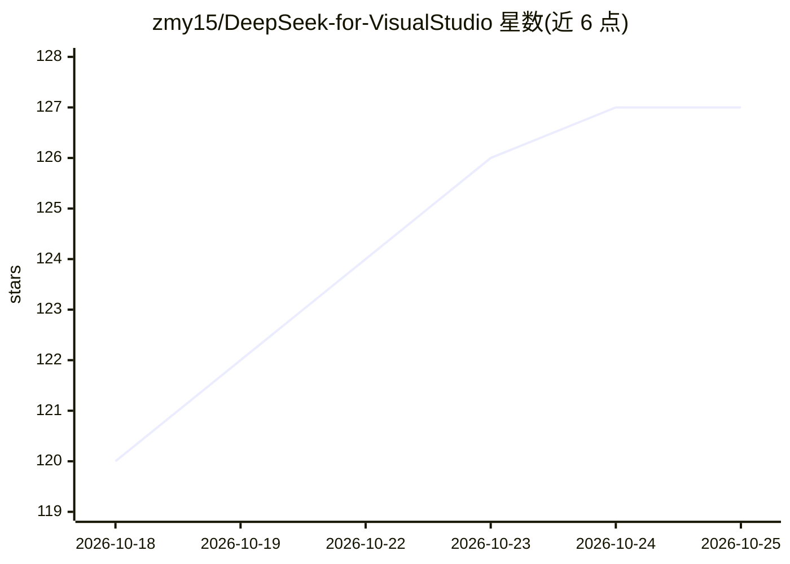

# zmy15/DeepSeek-for-VisualStudio

⭐ 129 · C# · MIT · 推送 2026-10-24 · [GitHub](https://github.com/zmy15/DeepSeek-for-VisualStudio) · [官网](https://marketplace.visualstudio.com/items?itemName=zmy15.DS4-VS) · 个人维护 · 中文 README

**Visual Studio 的 AI 编程助手扩展：对话、行内补全与五个自主 agent**

面向 Visual Studio 2022/2026 的 IDE 扩展，提供 AI 对话、行内编辑、Ghost Text 补全与五个协作 agent（Ask/Explore/Plan/Edit/Build，经 Handoff 协议路由），可在 IDE 内执行终端命令、Git 操作与构建验证。支持官方 DeepSeek API 及任意 OpenAI 兼容 chat/completions 端点（自定义 Base URL）。另含 SKILL.md 技能系统、MCP 工具服务器、900K token 上下文预算、多模态输入（图像/PDF/OCR）与百度千帆/DuckDuckGo 搜索。以 .vsix 安装包分发，Windows 10/11，x64（No-Local-OCR 包支持 ARM64）。

## 筛选速览

| 维度 | 判定 | 备注 |
|---|---|---|
| AI 角色 | `ai-native` | 本体是模型或模型工具 |
| 许可风险 | `permissive` | MIT |
| 部署形态 | `None` |  |
| 模型依赖 | locked-api |  |
| 硬件要求 | — | 无带数字的原话,不猜 |
| 安装摩擦 | `medium` | 含编译或系统依赖之一 |
| 成熟度 | — | 结构信号不足 |

## 能力要点

- 五个 agent（Ask/Explore/Plan/Edit/Build）通过 Handoff 协议协作
- 支持任意 OpenAI 兼容端点（自定义 Base URL）
- SKILL.md 技能系统与 MCP（HTTP/stdio）工具服务器集成
- 多模态理解：图像、截图、PDF 分页阅读与 OCR

## 适用场景

- 在 Visual Studio 内通过对话与行内编辑完成代码修改
- 让 agent 探索仓库、拆解任务、打补丁并验证构建
- 通过自定义 Base URL 接入自选的 OpenAI 兼容模型服务

## 场景标签

`代码生成` `编码 Agent` · 领域:编码与开发

## 证据(README 行号)

> L16: DeepSeek for Visual Studio brings AI chat, code editing, solution-aware tools, terminal execution, and multimodal u
> L18: The extension combines a native-grade WebView2 chat experience with five cooperating agents, reusable Skills, MCP t
> L50: - **Chat and reasoning**: streaming responses, Deep Reasoning, Pro/Flash models, resumable streaming, and Prefix Ca

## 星数曲线

2026-10-18 120 → 2026-10-25 127（+7）

---
*卡片 v1 · prompt 1.4 · 生成 2026-10-23 · 置信度 high · 依据 README sha `127972df5e5a` · [字段定义](../../DATASET.md)*
