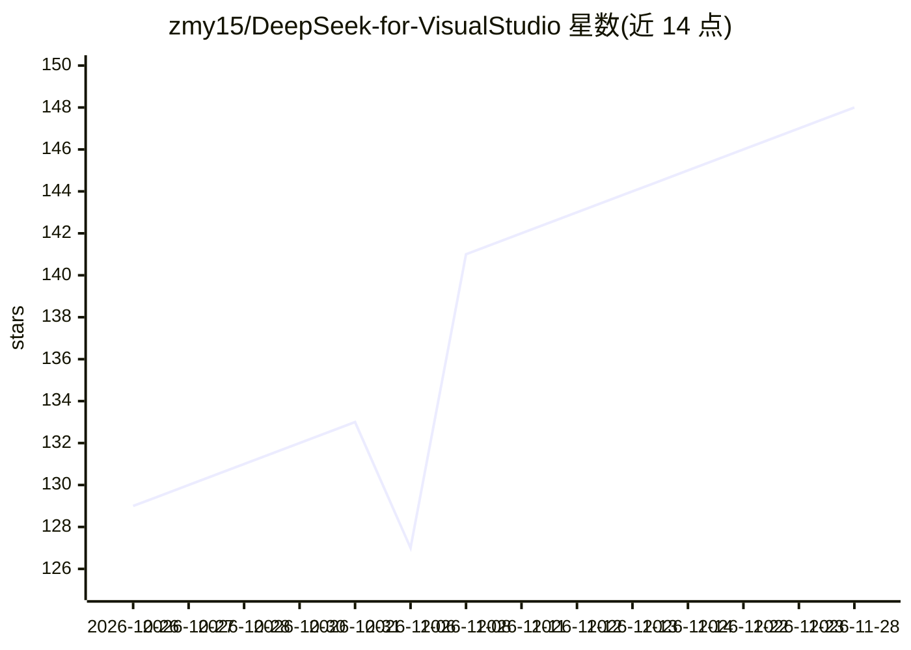

# zmy15/DeepSeek-for-VisualStudio

⭐ 148 · C# · MIT · 推送 2026-11-27 · [GitHub](https://github.com/zmy15/DeepSeek-for-VisualStudio) · [官网](https://marketplace.visualstudio.com/items?itemName=zmy15.DS4-VS) · 个人维护 · 中文 README

**面向 Visual Studio 用户的 DeepSeek 编码助手扩展**

一个 VSIX 形式的 Visual Studio 扩展，在 IDE 内提供流式聊天、行内代码补全与五个专职 Agent（Ask/Explore/Plan/Edit/Build），可读取搜索解决方案、修改文件、运行构建测试、操作 Git 与浏览器，所有写操作经审批模式控制；30 个内置工具加 MCP 工具。默认使用 DeepSeek 官方 API，也可配置任意 OpenAI 兼容端点。通过 Releases 下载 .vsix 安装，需 Visual Studio 2022 17.14+ 或 2026、Windows x64、.NET Framework 4.7.2。

## 筛选速览

| 维度 | 判定 | 备注 |
|---|---|---|
| AI 角色 | `ai-native` | 本体是模型或模型工具 |
| 许可风险 | `permissive` | MIT |
| 部署形态 | `desktop` | 安装包/桌面程序 |
| 模型依赖 | locked-api |  |
| 硬件要求 | — | 无带数字的原话,不猜 |
| 安装摩擦 | `high` | 编译与系统依赖俱全 |
| 成熟度 | — | 结构信号不足 |

## 能力要点

- 五个专职 Agent 通过 request_handoff 交接，3 个并行 Explore 子 Agent
- 30 个内置工具加 MCP 工具，读写边界在运行时强制执行
- AI 改动以逐 hunk 可审阅 diff 呈现，破坏性操作前自动备份
- 双语 UI（2,100+ 本地化字符串），本地 OCR 支持 PaddleOCR 与 Windows 内置引擎

## 适用场景

- 在 Visual Studio 内对话式解释代码、修 bug、写测试
- 让 Agent 制定多文件改动计划并逐步执行、构建验证
- 接入自定义 OpenAI 兼容端点进行行内补全与编辑

## 场景标签

`编码 Agent` · 领域:编码与开发

## 证据(README 行号)

> L21: **DeepSeek Chat for Visual Studio** is a VSIX extension that brings a full agentic coding assistant into the
> L93: **Agentic** — five specialised agents (Ask / Explore / Plan / Edit / Build) that hand work off to each other;
> L105: **Platform** — a fully bilingual UI with 2,100+ localized strings (including system prompts); DeepSeek official
> L124: The default provider requires a DeepSeek API key (platform.deepseek.com);

## 星数曲线

2026-10-26 129 → 2026-11-28 148（+19）

---
*卡片 v1 · prompt 1.4 · 生成 2026-11-28 · 置信度 high · 依据 README sha `352a738cd8be` · [字段定义](../../DATASET.md)*
