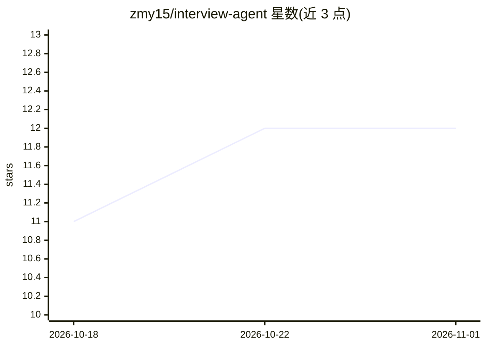

# zmy15/interview-agent

⭐ 12 · Python · MIT · 推送 2026-10-26 · [GitHub](https://github.com/zmy15/interview-agent) · 个人维护 · 中文 README

**基于 DeepSeek 的 AI 模拟面试平台：双视角演练 + RAG + 实时辅助**

FastAPI + React + DeepSeek 构建的 AI 模拟面试平台，面向求职准备者。提供双模式：用户扮演面试官向 AI 求职者提问，或 AI 扮演面试官按 JD 与简历出题并生成多维度评估报告。结合 FAISS 向量知识库（支持上传 PDF/Word/代码等）与 DuckDuckGo 联网搜索。针对真实面试场景提供 Windows 专属的截图答题（视觉模型）、系统音频转写（WASAPI）与语音输入朗读。上下文按固定顺序组织以命中 DeepSeek 前缀缓存；支持 Docker Compose、单容器、本地脚本与 Windows 独立窗口等多种部署形态。

## 筛选速览

| 维度 | 判定 | 备注 |
|---|---|---|
| AI 角色 | `ai-native` | 本体是模型或模型工具 |
| 许可风险 | `permissive` | MIT |
| 部署形态 | `desktop` | 安装包/桌面程序 |
| 模型依赖 | locked-api |  |
| 硬件要求 | — | 无带数字的原话,不猜 |
| 安装摩擦 | `low` | 无编译、无系统依赖或容器化 |
| 成熟度 | — | 结构信号不足 |

## 能力要点

- 双模式面试演练（面试官/求职者视角），按 JD、简历与候选人级别出题并生成评估报告
- RAG 向量知识库（FAISS + sentence-transformers）与 DuckDuckGo 联网搜索增强回答
- Windows 专属实时辅助：截图答题（Windows Graphics Capture）、系统音频转写（WASAPI Loopback）、STT/TTS
- 上下文固定为 prompt→简历→JD→问答，设计用于稳定命中 DeepSeek 服务端前缀缓存

## 适用场景

- 求职者按目标岗位 JD 与简历进行 AI 模拟面试并获得评估报告
- 面试官视角练习提问并验证候选人口径
- 上传个人资料与项目代码构建知识库辅助面试问答
- 真实面试中用截图答题与音频转写获取实时辅助（Windows）

## 场景标签

 · 领域:AI 面试/求职应用

## 证据(README 行号)

> L21: Interview Agent 是一个基于大语言模型的 **AI 模拟面试平台**。它把「准备面试」这件事拆成两个可自由切换的视角，并结合 RAG 向量知识库与联网搜索，让每一轮对话都带上岗位 JD、简历与知识库的上下文。
> L27: |🎯 **你是面试官**（`interviewer`）|你扮演面试官向 AI 求职者提问。AI 结合岗位 JD、简历、代码与知识库给出专业回答，适合练习提问技巧、快速验证候选人口径|
> L28: |🧑 **你是求职者**（`candidate`）|AI 扮演面试官向你提问。系统按 JD 与简历出题，支持设置时长、推算题量、追踪进度，结束后生成多维度评估报告|

## 星数曲线

2026-10-18 11 → 2026-11-01 12（+1）

---
*卡片 v1 · prompt 1.4 · 生成 2026-10-31 · 置信度 mid · 依据 README sha `1d38a321b0a2` · [字段定义](../../DATASET.md)*
