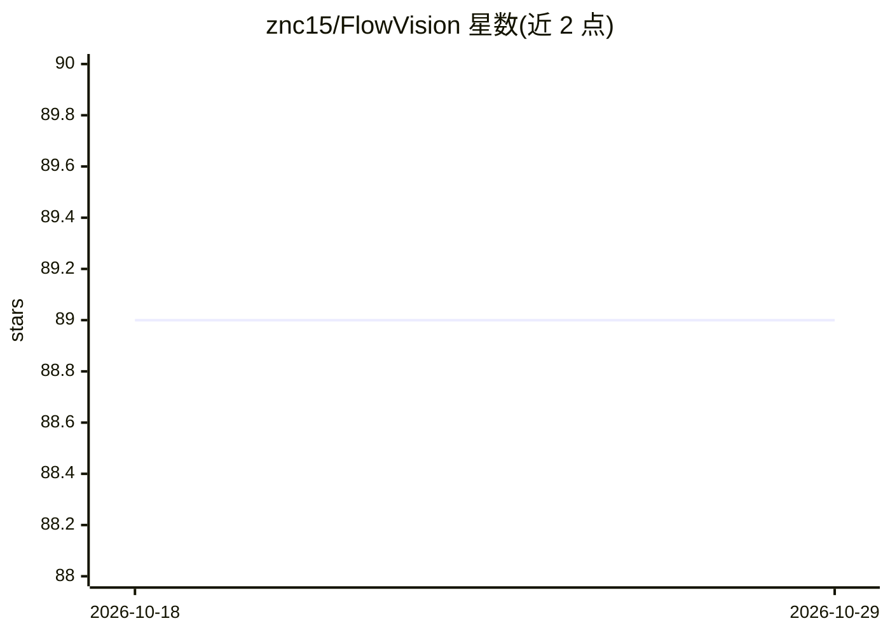

# znc15/FlowVision

⭐ 89 · TypeScript · MIT · 推送 2026-05-08 · [GitHub](https://github.com/znc15/FlowVision) · [官网](https://znc15.github.io/FlowVision/) · 个人维护 · 中文 README

**AI 驱动的流程图设计工具：分析代码并生成架构图**

基于 React + Electron 的流程图设计应用：用户用自然语言描述需求，AI 生成完整流程图，支持 OpenAI / Anthropic / DeepSeek / Ollama 多模型切换；可导入本地或 GitHub / Gitee 项目分析代码结构并生成可视化架构图。画布提供 39 种节点类型、8 种图表类型的可视化编辑与自动布局。内置 MCP 服务器暴露 23 个工具，供 Claude Desktop、Cursor、VS Code 等客户端实时操作流程图，也可接入外部 MCP 服务器（如 GrokSearch 联网搜索）。Web 模式需从源码运行，桌面端提供 Windows / macOS / Linux 安装包。

## 筛选速览

| 维度 | 判定 | 备注 |
|---|---|---|
| AI 角色 | `ai-native` | 本体是模型或模型工具 |
| 许可风险 | `permissive` | MIT |
| 部署形态 | `desktop` | 安装包/桌面程序 |
| 模型依赖 | local-ok | 支持本地模型 |
| 硬件要求 | — | 无带数字的原话,不猜 |
| 安装摩擦 | `low` | 无编译、无系统依赖或容器化 |
| 成熟度 | — | 结构信号不足 |

## 能力要点

- 自然语言生成流程图，支持 OpenAI / Anthropic / DeepSeek / Ollama 多模型
- 导入本地或 GitHub / Gitee 项目，AI 分析代码结构生成架构图
- 内置 MCP 服务器暴露 23 个工具，外部 AI 客户端可实时操作流程图
- 39 种节点类型覆盖 8 种图表，支持拖拽编辑、自动布局与多格式导出

## 适用场景

- 用自然语言快速生成流程图、ER 图、时序图等
- 导入项目代码自动生成可视化架构图
- 在 Claude Desktop / Cursor 中通过 MCP 直接操作画布上的流程图

## 场景标签

 · 领域:开发工具/图表可视化

## 证据(README 行号)

> L15: 用自然语言描述需求，AI 自动生成完整流程图。
> L24: 导入本地或 GitHub 项目，AI 深度分析代码结构、

## 星数曲线

2026-10-18 89 → 2026-10-29 89（+0）

---
*卡片 v1 · prompt 1.4 · 生成 2026-10-23 · 置信度 mid · 依据 README sha `c4894f4084cb` · [字段定义](../../DATASET.md)*
