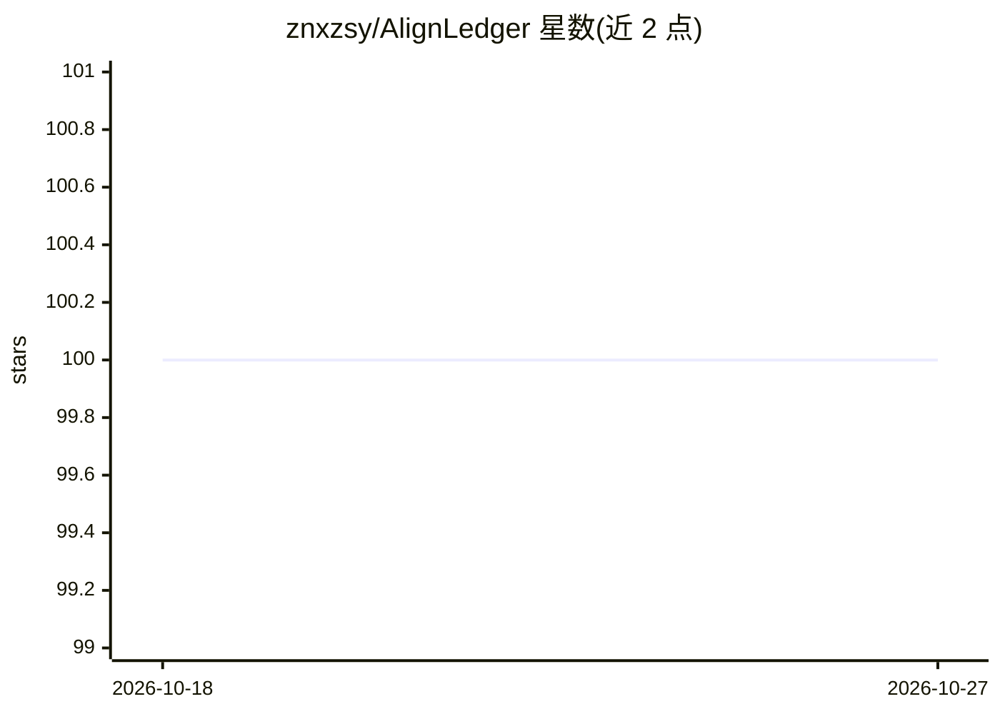

# znxzsy/AlignLedger

⭐ 100 · Python · MIT · 推送 2026-08-27 · [GitHub](https://github.com/znxzsy/AlignLedger) · 个人维护 · 中文 README

**面向 RLHF/SFT/DPO 的可审计人工反馈标注与审核系统**

基于 Python 标准库与 SQLite 的小型标注与质检系统，服务于 RLHF、SFT、DPO/KTO 及多模态评估等人工反馈工作流。将模型输出、人工修正、二审、标注者身份与导出决策保存在同一条可审计记录中；每次写入带版本号与幂等键，支持草稿自动保存、随机/批量复核、终审裁定与带 SHA256 清单的冻结导出。提供一条命令启动的本地演示（生成合成数据）与 Docker 部署，可导入自有 details_*.json 数据；共享部署使用会话密钥与一次性邀请码绑定身份。

## 筛选速览

| 维度 | 判定 | 备注 |
|---|---|---|
| AI 角色 | `ai-ecosystem` | LLM/agent 周边工具 |
| 许可风险 | `permissive` | MIT |
| 部署形态 | `self-host` | docker 或自建部署 |
| 模型依赖 | — | README 未给出锁定关系 |
| 硬件要求 | — | 无带数字的原话,不猜 |
| 安装摩擦 | `low` | 无编译、无系统依赖或容器化 |
| 成熟度 | — | 结构信号不足 |

## 能力要点

- 每条写入带版本号与幂等键，编辑保留历史、二审不覆盖原标注
- 冻结导出附带清单、SHA256 与 FROZEN_OK 标记，未决修正不入导出
- 接受/修正/未决记录分池管理，含标注者与审核者的工作量与准确率表
- 导入器校验结构、哈希源文件并拒绝不安全的本地图片路径

## 适用场景

- 多人协作标注 RLHF/DPO 训练数据并追溯每条标签的修改者
- 对标注结果做二审与终审裁定，导出可审计的冻结训练集
- 多模态模型输出的评估与质检工作流

## 场景标签

`强化学习` · 领域:训练与推理

## 证据(README 行号)

> L10: AlignLedger is a small annotation and quality-control system for RLHF, SFT, DPO/KTO, multimodal evaluation, and oth
> L24: The server separates initial annotation, review, and final adjudication. Reviewers can sample records at random or 

## 星数曲线

2026-10-18 100 → 2026-10-27 100（+0）

---
*卡片 v1 · prompt 1.4 · 生成 2026-10-23 · 置信度 high · 依据 README sha `e6aaf245103f` · [字段定义](../../DATASET.md)*
