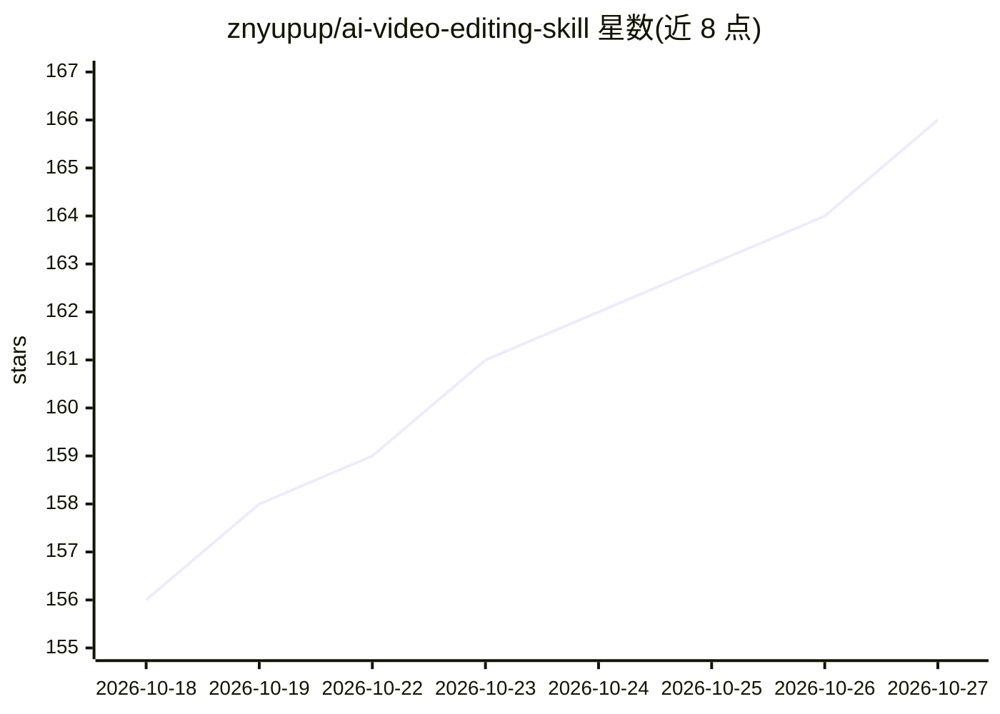

# znyupup/ai-video-editing-skill

⭐ 166 · Python · MIT · 推送 2026-04-27 · [GitHub](https://github.com/znyupup/ai-video-editing-skill) · 个人维护 · 中文 README

**给 AI Agent 用的旅行 Vlog 自动剪辑技能文件**

一份供 AI Agent（Claude Code / OpenClaw 等）加载的 Skill 知识文件，定义从原始手机素材到成品 Vlog 的四步工作流：Whisper 转录语音、抽帧加视觉 API 理解画面、音量检测，随后按三幕式结构编排、生成浏览器 Dashboard 供人确认、再用 ffmpeg 渲染输出成品。依赖 ffmpeg 与 Python 3.9+，需自备视觉模型 API Key（智谱免费/GPT-4o/Qwen-VL 等）。针对旅行 Vlog 优化，含 24 条踩坑经验。

## 筛选速览

| 维度 | 判定 | 备注 |
|---|---|---|
| AI 角色 | `ai-knowledge` | 知识聚合/清单类 |
| 许可风险 | `permissive` | MIT |
| 部署形态 | `None` |  |
| 模型依赖 | — | README 未给出锁定关系 |
| 硬件要求 | — | 无带数字的原话,不猜 |
| 安装摩擦 | `medium` | 含编译或系统依赖之一 |
| 成熟度 | — | 结构信号不足 |

## 能力要点

- SKILL.md 定义完整工作流：分析→编排→预览确认→渲染四步
- Whisper 转录 + 视觉 API 理解画面 + 音量检测的素材分析
- 交互式 Dashboard 网页预览分镜与素材
- 不依赖剪辑软件，ffmpeg + Pillow 完成渲染与标题

## 适用场景

- 旅行回来把素材文件夹丢给 AI Agent，自动剪出 Vlog
- 不用学剪辑软件就得到带标题、BGM 的成品视频
- 在浏览器里预览分镜方案并让 Agent 按反馈调整

## 场景标签

`图像视频处理` · 领域:感知与多模态

## 证据(README 行号)

> L13: 这是一份给 AI Agent（Claude Code / Hermes / OpenClaw / GPT 等）使用的 **Skill 文件**，定义了从原始素材到成品视频的完整自动剪辑工作流。
> L15: 它不是一个传统的软件程序——而是一份**指导 AI Agent 工作的知识文件**，包含：
> L138: ├── SKILL.md                    # 🧠 核心：完整工作流定义（给 AI Agent 读的）

## 星数曲线

2026-10-18 156 → 2026-10-27 166（+10）

---
*卡片 v1 · prompt 1.4 · 生成 2026-10-22 · 置信度 high · 依据 README sha `4a501aaab64c` · [字段定义](../../DATASET.md)*
