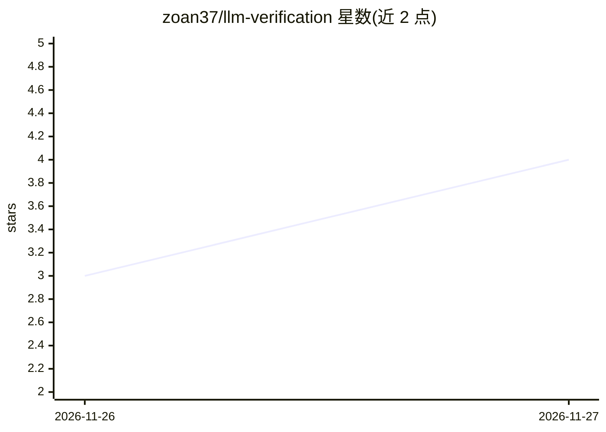

# zoan37/llm-verification

⭐ 4 · HTML · MIT · 推送 2026-11-26 · [GitHub](https://github.com/zoan37/llm-verification) · [官网](https://zoan.space/llm-verification/) · 个人维护

**审计 LLM API 端点真伪并提供可验证推理回执协议**

针对“API 端点是否真的在服务声称的模型”这一问题提供两套机制：黑盒审计模式下，运行真实权重的 referee 对任意 OpenAI 兼容端点（如 OpenRouter 上的各 provider）的回复重放打分，输出距离、置信区间、0-100 保真分与完整性标记；协作模式（llmverify 协议）要求 provider 运行其服务端，为每条回复附带对 prompt/output token 与 top-20 logprobs 的签名回执，支持事后复检。对 batch-invariant 模式下的 vLLM 协作 provider 提供逐位精确复现的 exact tier。以 Python 包形式提供，测试可在无 GPU 的 toy 模型上运行。

## 筛选速览

| 维度 | 判定 | 备注 |
|---|---|---|
| AI 角色 | `ai-ecosystem` | LLM/agent 周边工具 |
| 许可风险 | `permissive` | MIT |
| 部署形态 | `library` | 以包/库形式分发 |
| 模型依赖 | local-ok | 支持本地模型 |
| 硬件要求 | — | 无带数字的原话,不猜 |
| 安装摩擦 | `low` | 无编译、无系统依赖或容器化 |
| 成熟度 | `idea` | |

## 能力要点

- 黑盒审计：referee 重放回复并给出带置信区间的保真分与完整性标记
- llmverify 协议：每条回复附带签名回执，可事后复检
- exact tier：同组 GPU batch-invariant 下逐位精确复现
- 内置伪造 provider 攻击模拟与诚实基线校准流程

## 适用场景

- 审计 OpenRouter 等 API provider 是否真的在跑声称的模型
- 作为 provider 接入 llmverify 协议并出具签名回执
- 在 vLLM 上部署精确可验证的推理服务

## 场景标签

`模型评测` `网络安全` `LLM 可观测性` · 领域:评测与运维

## 证据(README 行号)

> L12: - **Black-box audits** of any OpenAI-compatible endpoint (e.g. every provider of a model on OpenRouter). A
> L36: At every step a language model assigns probabilities to every possible next token. A referee running the claimed

## 星数曲线

2026-11-26 3 → 2026-11-27 4（+1）

---
*卡片 v1 · prompt 1.4 · 生成 2026-11-26 · 置信度 high · 依据 README sha `960c9e8b846a` · [字段定义](../../DATASET.md)*
