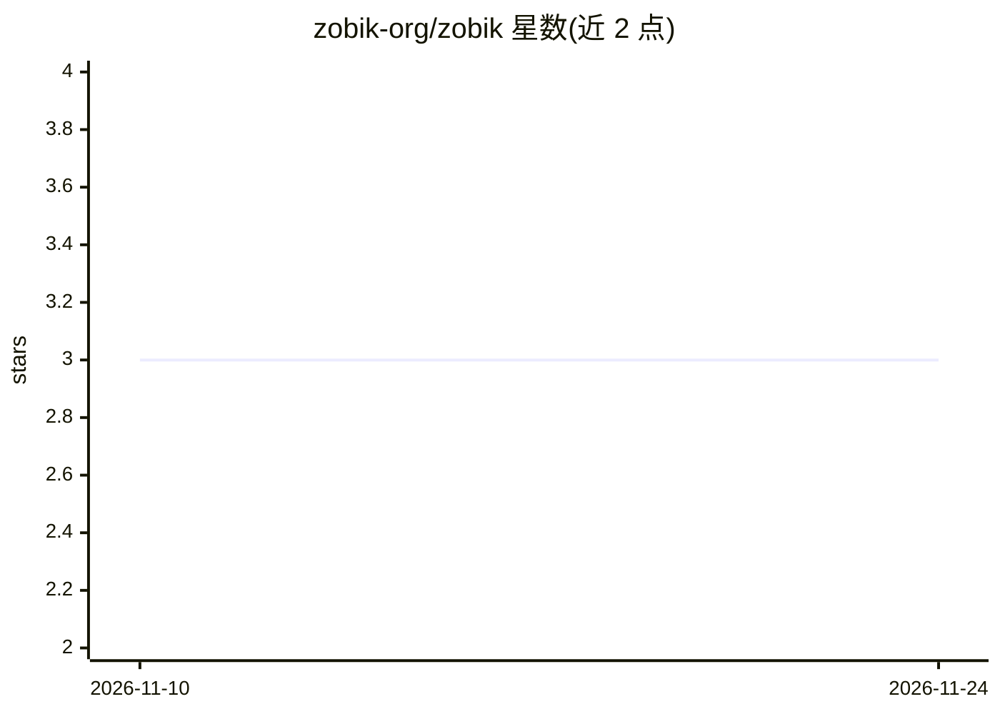

# zobik-org/zobik

⭐ 3 · Go · Apache-2.0 · 推送 2026-11-22 · [GitHub](https://github.com/zobik-org/zobik) · [官网](https://zobik.org) · 个人维护

**给开发者的去中心化 AI 节点网络：事件总线上的自组织多智能体系统**

Zobik 是基于 Blackboard 与 Pub/Sub 模式的事件驱动 Compound AI System：节点按主题订阅与语义相似度自选工作，在事件总线上竞争任务，无需中心控制器，网络可在不修改系统的情况下扩展新能力，组件之间互不知名。仓库含 zobik 二进制（操作台/命令行/结构角色）、Integration Sidecar、Node Runtime Interface 的 protobuf 定义、JSON Schema、Python 客户端 SDK、各角色 Dockerfile 与原生安装包目录。README 明确声明处于早期开发阶段，尚无可安装内容。

## 筛选速览

| 维度 | 判定 | 备注 |
|---|---|---|
| AI 角色 | `ai-ecosystem` | LLM/agent 周边工具 |
| 许可风险 | `permissive` | Apache-2.0 |
| 部署形态 | `self-host` | docker 或自建部署 |
| 模型依赖 | — | README 未给出锁定关系 |
| 硬件要求 | — | 无带数字的原话,不猜 |
| 安装摩擦 | `low` | 无编译、无系统依赖或容器化 |
| 成熟度 | `idea` | |

## 能力要点

- 无中心控制器的去中心化 AI 节点网络，节点经事件总线自选工作
- 节点通过主题订阅与语义相似度自行认领任务
- 提供 Node Runtime Interface（proto）与 Python 客户端 SDK
- 仓库含各角色 Dockerfile 与原生安装包目录

## 适用场景

- 在个人计算机上搭建单机运行的去中心化多智能体网络
- 用事件总线与 Blackboard 模式组合多个 AI 节点的能力
- 基于 sidecar 与 Node Runtime Interface 接入自定义逻辑容器

## 场景标签

`多智能体` `Agent 框架` · 领域:Agent 开发

## 证据(README 行号)

> L5: Zobik is an event-driven Compound AI System built on the Blackboard and Pub/Sub patterns. Nodes select themselves by
> L9: **Status: early development.** There is nothing to install yet.

## 星数曲线

2026-11-10 3 → 2026-11-24 3（+0）

---
*卡片 v1 · prompt 1.4 · 生成 2026-11-21 · 置信度 low · 依据 README sha `9d183d802ec9` · [字段定义](../../DATASET.md)*
