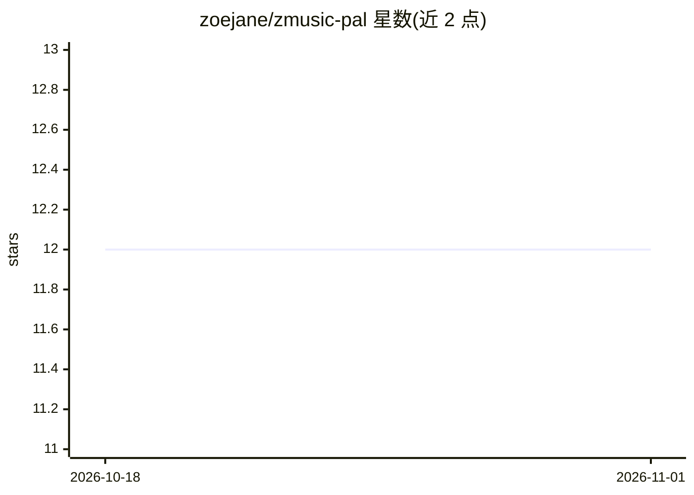

# zoejane/zmusic-pal

⭐ 12 · TypeScript · MIT · 推送 2026-09-14 · [GitHub](https://github.com/zoejane/zmusic-pal) · [官网](https://zmusic-pal.zoejane.net) · 个人维护 · 中文 README

**音乐人查调查和弦 Web 应用，附 AI 伙伴答疑（现已下线）**

基于 Next.js + React + TypeScript + Tailwind CSS 的移动端友好 Web 应用：输入调性查看音阶与常用三和弦，选择和弦查看组成音，面向作曲、练习与乐理探索。原项目含 AI 伙伴功能，通过 FastAPI 后端接入 Deepseek API 回答音乐问题；2026-09 起 AI 伙伴已暂时下线，发消息仅在本地显示固定通知，不再调用 AI API，查调查和弦与页面外观保留。现以 GitHub Pages 静态托管，后端代码仅留参考，本地用 npm ci && npm run build 构建。

## 筛选速览

| 维度 | 判定 | 备注 |
|---|---|---|
| AI 角色 | `ai-enhanced` | 去掉 AI 部分产品仍成立 |
| 许可风险 | `permissive` | MIT |
| 部署形态 | `library` | 以包/库形式分发 |
| 模型依赖 | — | README 未给出锁定关系 |
| 硬件要求 | — | 无带数字的原话,不猜 |
| 安装摩擦 | `low` | 无编译、无系统依赖或容器化 |
| 成熟度 | — | 结构信号不足 |

## 能力要点

- 输入调性输出音阶与 I-vi 常用三和弦对照
- 选择和弦查看组成音
- 原集成 Deepseek API 的 AI 伙伴（现已暂时下线）
- GitHub Pages 静态托管，移动端友好

## 适用场景

- 作曲或练习时快速查调性与和弦
- 移动设备上随时查阅乐理信息
- 曾用于向 AI 提问和弦进程、重新配和弦等问题

## 场景标签

 · 领域:音乐/乐理工具

## 证据(README 行号)

> L1: > **2026-09-14**：AI 伙伴暂时下线，发送消息会在本地显示固定通知，不再调用 AI API。查调、查和弦与页面外观保留。
> L36: Ask any music-related questions, and AI Pal will provide creative support and practical advice. For example:
> L71: - AI Integration: Deepseek API

## 星数曲线

2026-10-18 12 → 2026-11-01 12（+0）

---
*卡片 v1 · prompt 1.4 · 生成 2026-10-31 · 置信度 high · 依据 README sha `dd35e4560704` · [字段定义](../../DATASET.md)*
