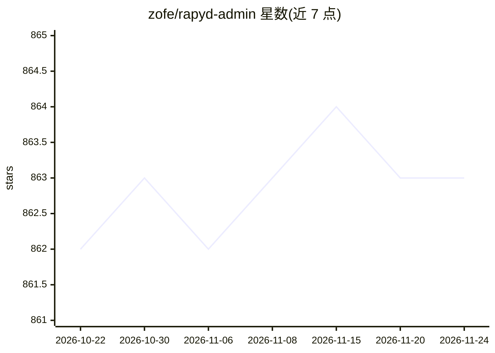

# zofe/rapyd-admin

⭐ 863 · PHP · MIT · 推送 2026-11-06 · [GitHub](https://github.com/zofe/rapyd-admin) · 个人维护

**面向 Laravel/SaaS 团队的开源后台管理面板**

基于 Livewire + Blade 的 Laravel 后台面板：生成器把普通组件与视图写入 app/Modules，附带统一 x-rpd:: 组件集、Fortify 认证与 2FA、Google 登录、Spatie 角色、1–3 层多租户、活动日志与全局搜索。AI 部分为可选项：面向 agent 的 rpd:context 简报与 guideline/skills 生成，以及独立的 zofe/ai-module（应用内聊天、模块声明的 AiTool 数据窗口、Presidio 个人数据掩码、日预算与费用台账）。要求 PHP 8.2+ 与 Livewire 4，核心 MIT 许可。

## 筛选速览

| 维度 | 判定 | 备注 |
|---|---|---|
| AI 角色 | `ai-enhanced` | 去掉 AI 部分产品仍成立 |
| 许可风险 | `permissive` | MIT |
| 部署形态 | `self-host` | docker 或自建部署 |
| 模型依赖 | local-ok | 支持本地模型 |
| 硬件要求 | — | 无带数字的原话,不猜 |
| 安装摩擦 | `low` | 无编译、无系统依赖或容器化 |
| 成熟度 | — | 结构信号不足 |

## 能力要点

- 生成器输出普通 Livewire/Blade 代码到 app/Modules，无资源类 DSL
- 内置认证、多租户公司层级、角色权限与活动日志等 SaaS 模块
- rpd:context / rpd:ai 生成 agent 简报与 AGENTS.md/CLAUDE.md 技能文件
- 可选 ai-module 提供应用内聊天、数据窗口白名单与费用台账

## 适用场景

- 为 Laravel SaaS 项目快速搭建带多租户的后台
- 让 AI agent 按项目 guideline 生成和修改管理模块
- 在管理面板内嵌入受数据权限约束的助手聊天

## 场景标签

`聊天机器人` · 领域:对话与助手

## 证据(README 行号)

> L10: **Rapyd Admin** is an open-source admin panel for Laravel: a light alternative to Nova, Filament and Backpack for t
> L21: - **AI inside the application.** ai-module: a chat for visitors or operators, tools the modules declare (each one r

## 星数曲线

2026-10-22 862 → 2026-11-24 863（+1）

---
*卡片 v1 · prompt 1.4 · 生成 2026-11-24 · 置信度 high · 依据 README sha `82c11f6ca56f` · [字段定义](../../DATASET.md)*
