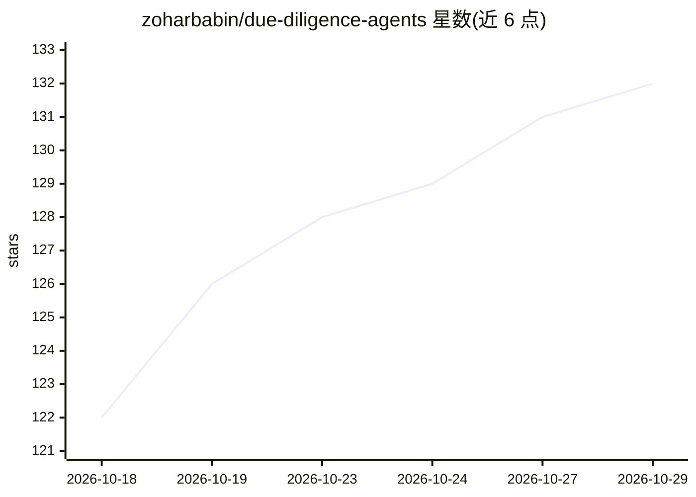

# zoharbabin/due-diligence-agents

⭐ 132 · Python · Apache-2.0 · 推送 2026-09-29 · [GitHub](https://github.com/zoharbabin/due-diligence-agents) · [官网](https://zoharbabin.com/due-diligence-agents/) · 个人维护

**开源 M&A 尽调工具：13 个 AI agent 读资料室并交叉引用发现**

面向企业并购与尽调团队的 CLI 工具：9 个领域专家 agent（法律、财务、商业、技术、网络安全、HR、税务、监管、ESG）并行读取整个资料室的 PDF/Word/Excel/PPT/图片（扫描件经 OCR），4 个编排综合 agent 做质量抽查、跨域交叉引用与 Go/No-Go 判定。采用直接阅读文档而非向量 RAG，引用与原文核对并有确定性复核。输出交互式 HTML 报告、16 表 Excel 与 JSON 发现。需 Python 3.12+ 与 LLM API key，本地执行、无遥测；声明不替代专业顾问。

## 筛选速览

| 维度 | 判定 | 备注 |
|---|---|---|
| AI 角色 | `ai-native` | 本体是模型或模型工具 |
| 许可风险 | `permissive` | Apache-2.0 |
| 部署形态 | `self-host` | docker 或自建部署 |
| 模型依赖 | locked-api |  |
| 硬件要求 | — | 无带数字的原话,不猜 |
| 安装摩擦 | `low` | 无编译、无系统依赖或容器化 |
| 成熟度 | — | 结构信号不足 |

## 能力要点

- 13 个 agent：9 领域专家 + 4 编排综合（Judge/执行综合/红旗扫描/收购方情报）
- 引用直接对照提取原文，P0/P1 引语做确定性复核
- 支持 Anthropic API、AWS Bedrock、Vertex AI 或任意兼容网关模型，无厂商锁定
- 5 道阻断式质量门，质量失败时停止而非输出不可靠结果，支持断点续跑

## 适用场景

- 并购尽调时对整个资料室做跨 9 域的首轮结构化分析
- 快速红旗分诊（GREEN/YELLOW/RED）后再决定是否投入完整分析
- 用自然语言 prompt 对合同库做定向提问并获得带引用的答案
- 与顾问协作产出 IC 备忘录、谈判清单与整合计划

## 场景标签

`多智能体` `文档问答` · 领域:Agent 开发

## 证据(README 行号)

> L5:  Legal flags a risk. Finance flags another. We connect and cite. Open-source forensic M&A due diligence — 13 AI agen
> L78: - **Interactive HTML report** — Go/No-Go verdict with executive narrative, progressive disclosure (decision → actio
> L243: |10|**Judge**|Adversarially spot-checks specialist findings for quality and consistency|

## 星数曲线

2026-10-18 122 → 2026-10-29 132（+10）

---
*卡片 v1 · prompt 1.4 · 生成 2026-10-23 · 置信度 mid · 依据 README sha `cc2e9fa0ec5e` · [字段定义](../../DATASET.md)*
