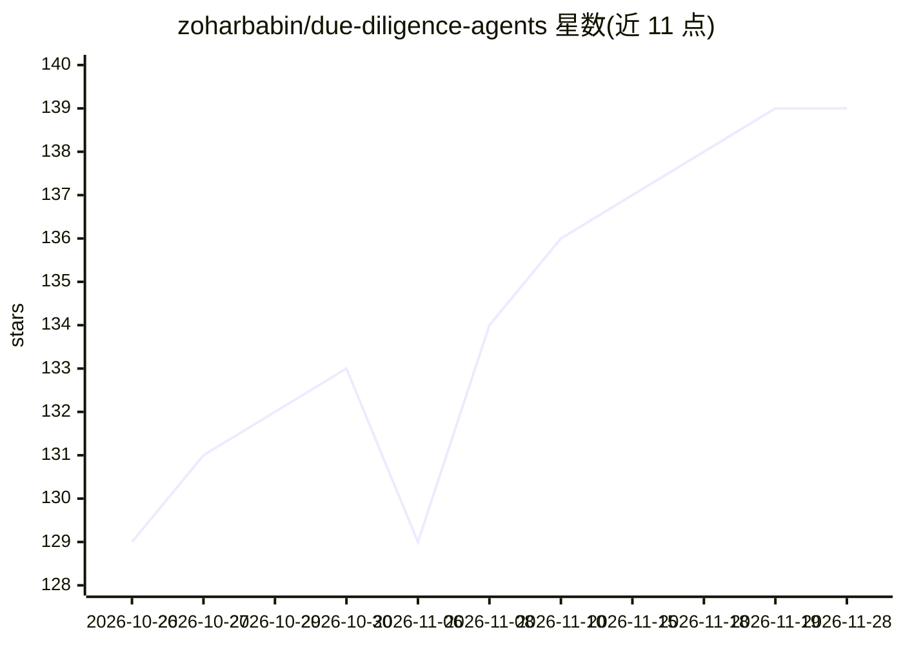

# zoharbabin/due-diligence-agents

⭐ 139 · Python · Apache-2.0 · 推送 2026-11-27 · [GitHub](https://github.com/zoharbabin/due-diligence-agents) · [官网](https://zoharbabin.com/due-diligence-agents/) · 个人维护

**面向 M&A 尽调团队的 13 个 AI agent 数据室跨域审查工具**

开源的并购尽职调查 CLI 工具：13 个 AI agent 并行读取 PDF/Word/Excel/PowerPoint/图片构成的数据室，覆盖 Legal、Finance、Commercial、Tech、Cyber、HR、Tax、Regulatory、ESG 九个领域，交叉比对单一审查者难以关联的发现，并将每条结论溯源到精确页码与原文引用。不采用向量 RAG，而是直接读取文档并对引用做确定性校验；流水线含 5 个阻断质量门，失败即中止。输出交互式 HTML 报告、16 表 Excel 与 JSON 发现。需 Python 3.12+ 与 LLM API key，文档文本会发送到所配置的 LLM 端点。

## 筛选速览

| 维度 | 判定 | 备注 |
|---|---|---|
| AI 角色 | `ai-native` | 本体是模型或模型工具 |
| 许可风险 | `permissive` | Apache-2.0 |
| 部署形态 | `self-host` | docker 或自建部署 |
| 模型依赖 | locked-api |  |
| 硬件要求 | — | 无带数字的原话,不猜 |
| 安装摩擦 | `low` | 无编译、无系统依赖或容器化 |
| 成熟度 | — | 结构信号不足 |

## 能力要点

- 13 个 agent（9 领域专家 + 4 个编排/合成 agent）并行分析数据室
- 引用溯源到精确页码与原文，P0/P1 引用做确定性保真复检
- 非向量 RAG：agent 直接读取文档并校验引用
- 通过 markdown 文件自定义 agent 人设与严重度（安全规则不可移除）

## 适用场景

- 并购 screening 阶段对数百份合同做九领域首次审查
- 小型 PE 团队在自有基础设施上跑全数据室尽调
- 对特定问题做定向合同检索并输出带引用的 Excel
- 生成 Go/No-Go 报告供 IC 备忘与谈判清单使用

## 场景标签

`多智能体` `文档问答` · 领域:Agent 开发

## 证据(README 行号)

> L5:  Legal flags a risk. Finance flags another. We connect and cite. Open-source forensic M&A due diligence — 13 AI agen
> L225: **9 domain specialists** analyze every document in parallel — each owns a domain and traces findings to exact cita
> L76: Analyzes every document through 9 domain lenses, cross-references findings, and validates quality through 5 blockin

## 星数曲线

2026-10-26 129 → 2026-11-28 139（+10）

---
*卡片 v1 · prompt 1.4 · 生成 2026-11-27 · 置信度 mid · 依据 README sha `b9cde6549f49` · [字段定义](../../DATASET.md)*
