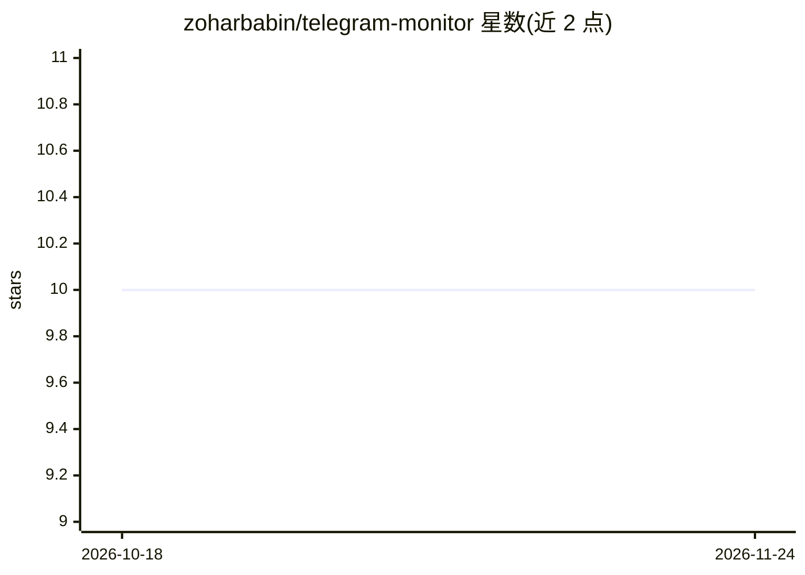

# zoharbabin/telegram-monitor

⭐ 10 · Python · MIT · 推送 2026-03-01 · [GitHub](https://github.com/zoharbabin/telegram-monitor) · 个人维护

**面向 OSINT 用户的 Telegram 频道实时监控与 AI 简报工具**

基于 Telethon（MTProto 用户客户端）实时采集所配置 Telegram 频道的消息，调用 Claude 对非英文内容进行翻译、分类与摘要，生成含紧急度评估、关键行为者、时间线重建与来源分析的结构化情报简报。前端为 Textual 三栏终端仪表盘（实时消息流、媒体墙、简报面板），支持照片/视频/GIF 自动下载与 iTerm2 内嵌图片，另提供 --log-only 无头模式供服务器部署，内置六个地区/主题配置档案，并可用交互式向导生成新档案。

## 筛选速览

| 维度 | 判定 | 备注 |
|---|---|---|
| AI 角色 | `ai-native` | 本体是模型或模型工具 |
| 许可风险 | `permissive` | MIT |
| 部署形态 | `None` |  |
| 模型依赖 | locked-api |  |
| 硬件要求 | — | 无带数字的原话,不猜 |
| 安装摩擦 | `low` | 无编译、无系统依赖或容器化 |
| 成熟度 | — | 结构信号不足 |

## 能力要点

- 实时监控 99+ Telegram 频道（Telethon MTProto 用户客户端）
- Claude 生成含紧急度评估与来源分析的结构化简报
- Textual 三栏终端仪表盘与 --log-only 无头模式
- 交互式 Claude 向导生成自定义频道配置档案

## 适用场景

- 跟踪特定地区冲突或安全局势的公开频道动态
- 网络安全威胁情报的频道聚合与摘要
- 非英文媒体内容的批量翻译与简报生成

## 场景标签

`网络安全` · 领域:学习与行业

## 证据(README 行号)

> L7: Real-time Telegram channel monitoring with AI-powered intelligence briefings.
> L16: - **AI-powered analysis** — Claude translates, categorizes, and summarizes messages into structured intelligence br
> L36: - **Claude API key** — obtain from console.anthropic.com (used via `claude-agent-sdk`)

## 星数曲线

2026-10-18 10 → 2026-11-24 10（+0）

---
*卡片 v1 · prompt 1.4 · 生成 2026-11-20 · 置信度 high · 依据 README sha `9e83d829e07b` · [字段定义](../../DATASET.md)*
