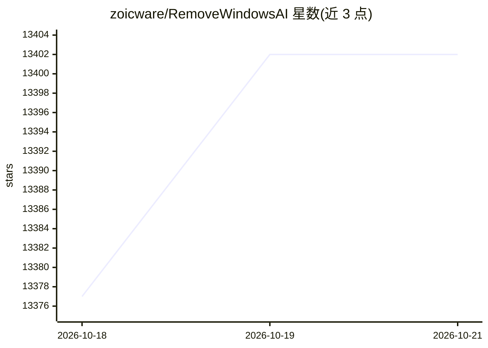

# zoicware/RemoveWindowsAI

⭐ 13,402 · PowerShell · MIT · 推送 2026-10-17 · [GitHub](https://github.com/zoicware/RemoveWindowsAI) · 个人维护

**给 Windows 11 用户移除 Copilot、Recall 等 AI 组件的 PowerShell 脚本**

一个 PowerShell 脚本，用于移除/禁用 Windows 11 中的 AI 组件：禁用 Copilot、Recall、语音访问、Office/Photos/画图/记事本等应用内的 AI 功能，删除 Appx 与 CBS 中的 AI 包，并通过自定义 Windows Update 包阻止 AI 包重装；支持安装经典版应用替代，提供 UI 启动、命令行参数、备份/还原模式。要求 Windows PowerShell 5.1（PowerShell 7 不支持），管理员权限运行，部分杀毒软件可能误报。

## 筛选速览

| 维度 | 判定 | 备注 |
|---|---|---|
| AI 角色 | `ai-ecosystem` | LLM/agent 周边工具 |
| 许可风险 | `permissive` | MIT |
| 部署形态 | `None` |  |
| 模型依赖 | — | README 未给出锁定关系 |
| 硬件要求 | — | 无带数字的原话,不猜 |
| 安装摩擦 | `low` | 无编译、无系统依赖或容器化 |
| 成熟度 | — | 结构信号不足 |

## 动量与使用信号

- 维护:`active` — 距上次 push 0.7 天,年发版 0,6 位贡献者
- 涨星:近 1 天 **+11**(自 20261016 起算)
- 平台:WINDOWS · 协议:—

## 能力要点

- 禁用 Copilot、Recall、Voice Access、Defender AI 等多项系统 AI 组件
- 删除含 Nonremovable 标记的 AI Appx 包与 CBS 隐藏包，并用自定义更新包阻止重装
- 支持 UI 启动与非交互式命令行参数、备份/还原模式
- 可安装 Notepad/Paint/截图工具/照片查看器的经典版本

## 适用场景

- 在 Windows 11 上移除 Copilot 和 Recall 等预装 AI 功能
- Windows 更新后清理新安装的 AI 组件（含定时检查任务）
- 用经典版应用替换内置 AI 化应用

## 场景标签

 · 领域:系统工具/隐私

## 证据(README 行号)

> L3: In Windows 11 22H2 Microsoft began adding AI features like Copilot and Recall. Since then, additional AI driven comp
> L65:  > Running the script with PowerShell 7 is no longer supported and it WILL cause issues, to avoid this ensure you a
> L70:  & ([scriptblock]::Create((irm "https://raw.githubusercontent.com/zoicware/RemoveWindowsAI/main/RemoveWindowsAi.ps1

## 星数曲线

2026-10-18 13,377 → 2026-10-21 13,402（+25）

---
*卡片 v1 · prompt 1.4 · 生成 2026-10-18 · 置信度 high · 依据 README sha `a300077808fa` · [字段定义](../../DATASET.md)*
