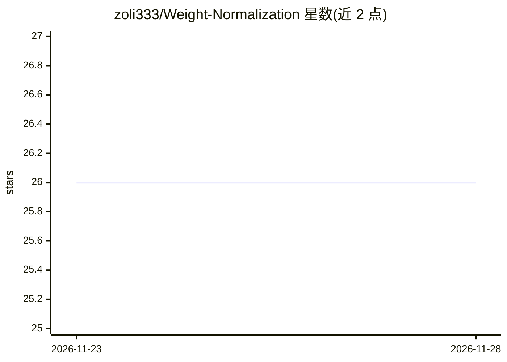

# zoli333/Weight-Normalization

⭐ 26 · Python · 推送 2026-11-23 · [GitHub](https://github.com/zoli333/Weight-Normalization) · 个人维护

**复现 Weight Normalization 论文的 PyTorch 实现库**

以 PyTorch 完整实现 Weight Normalization 论文（arXiv:1602.07868）中的方法：提供 6 种归一化变体（含初始化/无初始化的权重归一化、mean-only batch norm 组合、batch norm 与无归一化基线），可联合或单独运行，并记录了训练结果图与收敛、过拟合方面的实验结论。面向需要复现或使用该重参数化方法的深度学习研究者与开发者，需 PyTorch 2.1.1+cu118 环境，训练在 Google Colab 上以 train.py 执行。

## 筛选速览

| 维度 | 判定 | 备注 |
|---|---|---|
| AI 角色 | `ai-native` | 本体是模型或模型工具 |
| 许可风险 | `none` | — |
| 部署形态 | `None` |  |
| 模型依赖 | — | README 未给出锁定关系 |
| 硬件要求 | — | 无带数字的原话,不猜 |
| 安装摩擦 | `medium` | 含编译或系统依赖之一 |
| 成熟度 | — | 结构信号不足 |

## 能力要点

- 实现论文中的 6 种归一化变体，可联合或单独运行
- 基于 PyTorch 2.1.1+cu118
- 提供训练/测试结果图与实验结论记录
- 训练过程保持确定性（固定示例顺序与初始化批次）

## 适用场景

- 复现 Weight Normalization 论文的实验
- 在训练 CNN 时应用权重归一化重参数化
- 对比不同归一化方法的收敛行为

## 场景标签

 · 领域:深度学习研究/论文复现

## 证据(README 行号)

> L3: This is a complete Pytorch implementation of Weight Normalization:
> L6: https://arxiv.org/pdf/1602.07868.pdf
> L8: Version: Pytorch 2.1.1+cu118

## 星数曲线

2026-11-23 26 → 2026-11-28 26（+0）

---
*卡片 v1 · prompt 1.4 · 生成 2026-11-23 · 置信度 high · 依据 README sha `dd056637fe1d` · [字段定义](../../DATASET.md)*
