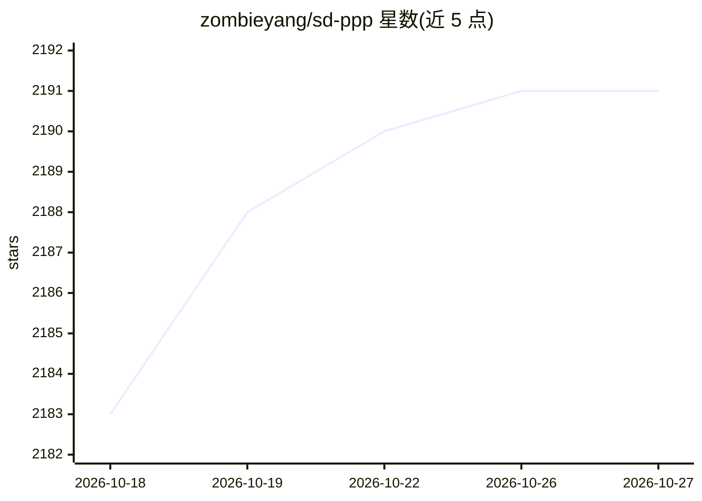

# zombieyang/sd-ppp

⭐ 2,191 · JavaScript · BSD-3-Clause · 推送 2026-02-05 · [GitHub](https://github.com/zombieyang/sd-ppp) · [官网](https://sdppp.zombee.tech/) · 个人维护 · 中文 README

**Photoshop 非官方 AI 插件：在 PS 内调用 ComfyUI 等生成图像**

Adobe Photoshop 的非官方 AI 插件：在 Photoshop 内选取图像/图层/选区，发送到 ComfyUI 工作流或 Replicate、RunningHUB 上的模型与应用，接收生成结果返回 PS 图层。2.0 版本无需 ComfyUI 自定义节点即可使用，支持 Nano-banana、Flux-Kontext-Pro/Max、Midjourney 等 RunningHUB 上的 API。以安装包形式分发，2.0 Beta 仅支持 Photoshop 2025（26.0+），采用 GPL-3.0 许可。

## 筛选速览

| 维度 | 判定 | 备注 |
|---|---|---|
| AI 角色 | `ai-native` | 本体是模型或模型工具 |
| 许可风险 | `permissive` | BSD-3-Clause |
| 部署形态 | `None` |  |
| 模型依赖 | — | README 未给出锁定关系 |
| 硬件要求 | — | 无带数字的原话,不猜 |
| 安装摩擦 | `low` | 无编译、无系统依赖或容器化 |
| 成熟度 | `idea` | |

## 能力要点

- 在 Photoshop 内直接调用 ComfyUI，2.0 起无需自定义节点
- 支持 Replicate 与 RunningHUB 上的任意模型和 AI 应用
- 支持 Nano-banana、Flux-Kontext-Pro/Max、Midjourney 等 API
- 快捷键选图与快速选取任意区域/图层/文档

## 适用场景

- 设计师在 Photoshop 内直接跑 Stable Diffusion 等生成流程
- 把 PS 图层送入 ComfyUI 工作流并将结果收回继续编辑
- 在 PS 内使用 RunningHUB/Replicate 上的图像模型 API

## 场景标签

`图像生成` · 领域:内容生成

## 证据(README 行号)

> L1: # SD-PPP: Unofficial Photoshop AI Plugin
> L7: **Latest: Support Nano-banana, Flux-Kontext-Pro/Max, Midjourney or any API via RunningHUB in Photoshop!**
> L18: * No custom nodes needed when using ComfyUI

## 星数曲线

2026-10-18 2,183 → 2026-10-27 2,191（+8）

---
*卡片 v1 · prompt 1.4 · 生成 2026-10-21 · 置信度 high · 依据 README sha `be0073bc207c` · [字段定义](../../DATASET.md)*
