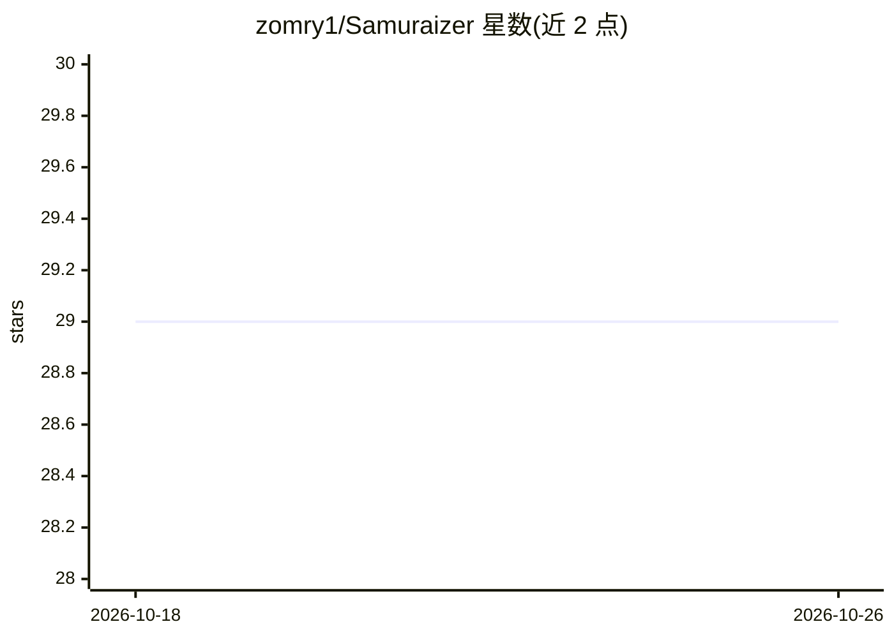

# zomry1/Samuraizer

⭐ 29 · JavaScript · MIT · 推送 2026-06-15 · [GitHub](https://github.com/zomry1/Samuraizer) · 个人维护

**面向安全研究者的自托管安全知识库引擎：自动摘要/打标/检索**

面向网络安全研究人员的自托管知识库系统：用户通过 Web UI 或 Telegram Bot 提交 URL、PDF、RSS/YouTube 内容，后端用 Gemini 2.5 Flash（或本地 Ollama）生成摘要、分类、标签与嵌入向量，存入 SQLite，支持语义+全文搜索、知识图谱可视化、RAG 引用式问答与钉选上下文对话。提供本地 Ollama 离线模式，可用 Docker Compose 或手动（Python+React）部署。YouTube 转录依赖第三方付费 API transcriptapi.com（有免费额度）。

## 筛选速览

| 维度 | 判定 | 备注 |
|---|---|---|
| AI 角色 | `ai-native` | 本体是模型或模型工具 |
| 许可风险 | `permissive` | MIT |
| 部署形态 | `self-host` | docker 或自建部署 |
| 模型依赖 | local-ok | 支持本地模型 |
| 硬件要求 | — | 无带数字的原话,不猜 |
| 安装摩擦 | `low` | 无编译、无系统依赖或容器化 |
| 成熟度 | — | 结构信号不足 |

## 能力要点

- URL/PDF/RSS/YouTube 内容自动摘要、打标并入库
- 基于向量嵌入的语义搜索与交互式知识图谱
- RAG 问答带来源引用与钉选上下文模式
- Ollama 本地模式可实现全离线运行

## 适用场景

- 收集和检索 CVE 报告、GitHub 仓库与安全博客并自动摘要
- 通过 Telegram Bot 转发链接即完成归档分析
- 在隔离/离线环境下用本地模型管理安全研究资料

## 场景标签

 · 领域:网络安全/知识管理

## 证据(README 行号)

> L102: 3. Content is sent to **Gemini 2.5 Flash** to generate:
> L74: - Ask questions over your knowledge base — answers are cited from the best matching entries

## 星数曲线

2026-10-18 29 → 2026-10-26 29（+0）

---
*卡片 v1 · prompt 1.4 · 生成 2026-10-26 · 置信度 high · 依据 README sha `a65f24538701` · [字段定义](../../DATASET.md)*
