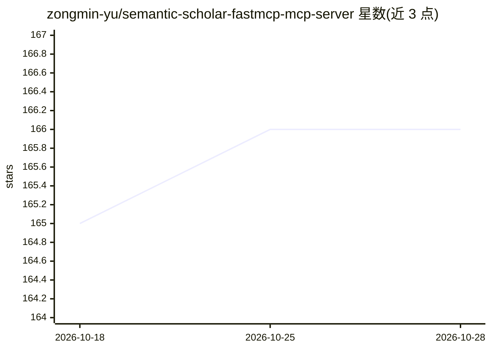

# zongmin-yu/semantic-scholar-fastmcp-mcp-server

⭐ 166 · Python · MIT · 推送 2026-03-20 · [GitHub](https://github.com/zongmin-yu/semantic-scholar-fastmcp-mcp-server) · 个人维护

**为 MCP 客户端接入 Semantic Scholar 学术数据的 FastMCP 服务器**

基于 FastMCP 实现的 Semantic Scholar API 服务器，向 MCP 客户端暴露 16 个工具，覆盖论文检索、引文与参考文献追踪、作者信息（含 h-index 等指标）、批量查询（单次最多 1000 个 ID）与论文推荐。支持认证与无认证两种访问模式并自动适配速率限制，API key 为可选项。另内置一个 HTTP 桥（默认 8000 端口）提供 REST 端点，供 MCP 之外的工作流直接调用。通过 pip/uvx/Smithery 安装。

## 筛选速览

| 维度 | 判定 | 备注 |
|---|---|---|
| AI 角色 | `ai-ecosystem` | LLM/agent 周边工具 |
| 许可风险 | `permissive` | MIT |
| 部署形态 | `library` | 以包/库形式分发 |
| 模型依赖 | — | README 未给出锁定关系 |
| 硬件要求 | — | 无带数字的原话,不猜 |
| 安装摩擦 | `low` | 无编译、无系统依赖或容器化 |
| 成熟度 | — | 结构信号不足 |

## 能力要点

- 16 个 MCP 工具：论文检索、引文网络、作者信息、推荐
- 单次批量查询支持最多 1000 个论文/作者 ID
- 内置 HTTP 桥暴露 REST 端点，复用统一限速与连接池
- 支持认证/无认证双模式并自动适配速率限制

## 适用场景

- 在 Claude 等 MCP 客户端中检索和追踪学术论文
- 通过 REST 接口批量获取论文与作者元数据
- 基于引用关系做文献综述与引文溯源

## 场景标签

`科研工具` · 领域:学习与行业

## 证据(README 行号)

> L7: A FastMCP server implementation for the Semantic Scholar API, providing comprehensive access to academic paper data,
> L195: The server currently exposes 16 MCP tools.

## 星数曲线

2026-10-18 165 → 2026-10-28 166（+1）

---
*卡片 v1 · prompt 1.4 · 生成 2026-10-23 · 置信度 high · 依据 README sha `6a47010c0308` · [字段定义](../../DATASET.md)*
