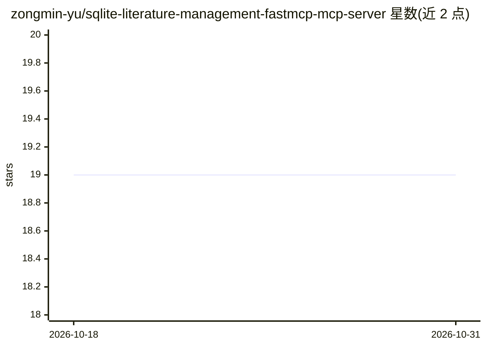

# zongmin-yu/sqlite-literature-management-fastmcp-mcp-server

⭐ 19 · Python · MIT · 推送 2026-03-09 · [GitHub](https://github.com/zongmin-yu/sqlite-literature-management-fastmcp-mcp-server) · 个人维护

**SQLite 文献与来源管理的 FastMCP 服务器，供 MCP 客户端调用**

基于 FastMCP 的本地 stdio MCP 服务器，在 SQLite 数据库中管理文献、笔记、实体链接与阅读清单。提供 15 个工具（批量添加来源、添加笔记/标识符、实体链接读写、只读数据库检查等）与 source://、reading-list://、entity:// 等 MCP 资源；支持 semantic_scholar/doi/arxiv/pmid 等 7 类标识符与 8 种实体关系类型（discusses/supports/contradicts 等）。可通过 fastmcp install 安装或 Docker 打包运行；不集成外部记忆图谱，老版本数据库需手动迁移。

## 筛选速览

| 维度 | 判定 | 备注 |
|---|---|---|
| AI 角色 | `ai-ecosystem` | LLM/agent 周边工具 |
| 许可风险 | `permissive` | MIT |
| 部署形态 | `self-host` | docker 或自建部署 |
| 模型依赖 | — | README 未给出锁定关系 |
| 硬件要求 | — | 无带数字的原话,不猜 |
| 安装摩擦 | `low` | 无编译、无系统依赖或容器化 |
| 成熟度 | — | 结构信号不足 |

## 能力要点

- 15 个 MCP 工具覆盖来源批量导入、笔记、标识符与实体链接管理
- 7 类标识符（doi/arxiv/pmid 等）与 8 种实体关系类型
- 重复处理：标识符精确命中返回已有条目，标题模糊匹配提示潜在重复
- Docker 打包为 stdio MCP 服务器，容器可自动初始化数据库

## 适用场景

- 通过 Claude 等 MCP 客户端管理论文、书籍、网页等阅读来源
- 为文献构建来源-实体关系链接（supports/contradicts 等）
- 维护带未读/阅读状态的个人阅读清单

## 场景标签

`科研工具` `知识库管理` · 领域:知识与检索

## 证据(README 行号)

> L3: A lightweight FastMCP server for managing literature, notes, entity links, and reading-list resources in a local SQL
> L29: fastmcp install sqlite-paper-fastmcp-server.py --name "Source Manager" -e SQLITE_DB_PATH=/path/to/sources.db
> L13: - MCP resources for source lookup and reading lists

## 星数曲线

2026-10-18 19 → 2026-10-31 19（+0）

---
*卡片 v1 · prompt 1.4 · 生成 2026-10-28 · 置信度 high · 依据 README sha `8d4c6d020a36` · [字段定义](../../DATASET.md)*
