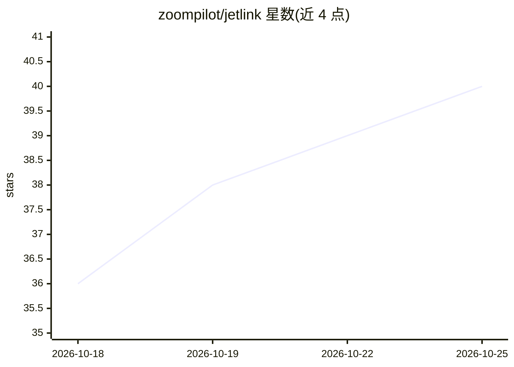

# zoompilot/jetlink

⭐ 40 · Swift · MIT · 推送 2026-10-18 · [GitHub](https://github.com/zoompilot/jetlink) · [官网](https://zoompilot.ai/jetlink) · 个人维护

**在电脑上运行 openpilot 大型驾驶模型的工具**

Jetlink 将 openpilot 的大型驾驶模型放到外接电脑上运行，通过 USB 3 数据线连接 comma 3X/4 设备（需运行支持 Jetlink 的 openpilot 分支）。支持 Jetson Orin Nano Super、Apple silicon Mac、带 NVIDIA GPU 的 Linux PC、iPhone/iPad（TestFlight）与 Android（实验性）。模型按帧处理并显示与 50ms 预算的对比；链路中断时 comma 提示接管并回退到小模型。项目自述为实验性。

## 筛选速览

| 维度 | 判定 | 备注 |
|---|---|---|
| AI 角色 | `ai-ecosystem` | LLM/agent 周边工具 |
| 许可风险 | `permissive` | MIT |
| 部署形态 | `None` |  |
| 模型依赖 | — | README 未给出锁定关系 |
| 硬件要求 | — | 无带数字的原话,不猜 |
| 安装摩擦 | `low` | 无编译、无系统依赖或容器化 |
| 成熟度 | `idea` | |

## 能力要点

- 在 Jetson/Mac/Linux PC/iOS/Android 上运行 openpilot 大型驾驶模型
- comma 通过 USB 3 数据线连接，链路断开时回退小模型并提示接管
- 按帧显示处理时间与 50ms 预算的对比
- iOS 版通过 TestFlight 分发，Android 版为实验性

## 适用场景

- 为 comma 3X/4 外接算力运行更大规模的驾驶模型
- 在 Jetson、Mac 或 CUDA 笔记本上部署 openpilot 模型推理
- 用 iPhone/iPad 或 Android 手机充当推理主机（实验性）

## 场景标签

`推理引擎` · 领域:训练与推理

## 证据(README 行号)

> L5:  Run openpilot's large driving models on a computer connected to your comma.
> L7: **Jetlink is experimental.** It requires a comma running an openpilot fork
> L22: |Jetson Orin Nano Super|Set up a Jetson|

## 星数曲线

2026-10-18 36 → 2026-10-25 40（+4）

---
*卡片 v1 · prompt 1.4 · 生成 2026-10-25 · 置信度 high · 依据 README sha `5320096645f5` · [字段定义](../../DATASET.md)*
