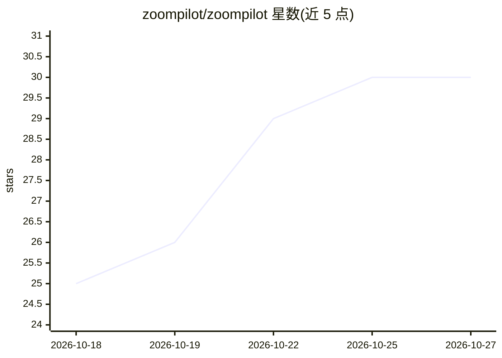

# zoompilot/zoompilot

⭐ 30 · Python · MIT · 推送 2026-10-26 · [GitHub](https://github.com/zoompilot/zoompilot) · [官网](https://zoompilot.ai) · 个人维护

**面向马自达 CX-5/CX-9 的开源驾驶辅助系统（sunnypilot 分支）**

sunnypilot 的马自达优化分支，运行在 comma 设备上，目标为 2022-2025 款 CX-5 提供转向控制与全部 sunnypilot 功能。机制包括：编码随速度变化的 EPS 转矩上限曲线、按七个速度区间自学习横向参数、读取原厂前向雷达/盲区监测/限速标志并与摄像头融合、通过模拟方向盘按键接管原厂巡航调速。安装方式为在 comma 设备设置时输入自定义软件 URL（zoompilot/main），发布版本预先编译。作者声明为实验性软件，无保修；采用需许可的自定义许可（基于 sunnypilot/openpilot 条款）。

## 筛选速览

| 维度 | 判定 | 备注 |
|---|---|---|
| AI 角色 | `ai-native` | 本体是模型或模型工具 |
| 许可风险 | `permissive` | MIT |
| 部署形态 | `None` |  |
| 模型依赖 | — | README 未给出锁定关系 |
| 硬件要求 | — | 无带数字的原话,不猜 |
| 安装摩擦 | `low` | 无编译、无系统依赖或容器化 |
| 成熟度 | `idea` | |

## 能力要点

- 编码 EPS 随速度变化的转矩上限曲线与全速率转向指令
- 读取原厂前向雷达、盲区监测与限速标志并融合
- ICBM/Smart Cruise 按键管理与弯道减速（视觉或离线地图）
- 支持 CX-9 与 2022+ EPS 转向机移植（按固件指纹识别）

## 适用场景

- 在 2022-2025 CX-5/CX-9 上获得转向与巡航辅助功能
- 利用原厂雷达与盲区传感器增强车道变换与前车感知
- 按限速标志与弯道自动调整巡航车速

## 场景标签

 · 领域:汽车/自动驾驶辅助

## 证据(README 行号)

> L3: A Mazda-optimized fork of sunnypilot for the CX-5 and CX-9. My goal is to enable the best steering possible and supp
> L25: - **Speed-dependent torque.** The EPS caps the steering torque it will deliver, and that cap changes with speed. We

## 星数曲线

2026-10-18 25 → 2026-10-27 30（+5）

---
*卡片 v1 · prompt 1.4 · 生成 2026-10-26 · 置信度 high · 依据 README sha `a277f1fe4df6` · [字段定义](../../DATASET.md)*
