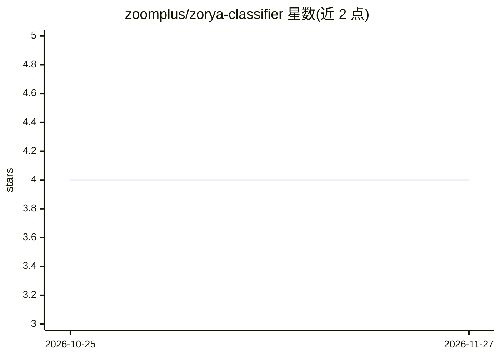

# zoomplus/zorya-classifier

⭐ 4 · TypeScript · MIT · 推送 2026-11-02 · [GitHub](https://github.com/zoomplus/zorya-classifier) · [官网](https://www.npmjs.com/package/zorya-classifier) · 个人维护

**面向 Node/TS 开发者的文本/图像分类与空间定位库**

Provider-independent 的 TypeScript 分类库：通过应用显式注入的 DecisionPort 或配置的适配器调用模型，支持封闭类目分类、区域网格定位、caller 自备分割器产出 mask 派生的边界框与透明抠图。库本身不选模型、不下载数据。Node.js 22.12+ 必需，npm 安装，另有 MCP server 包提供 stdio/HTTP 传输。定位能力有限：60 个正样本中 8 个完整框。

## 筛选速览

| 维度 | 判定 | 备注 |
|---|---|---|
| AI 角色 | `ai-native` | 本体是模型或模型工具 |
| 许可风险 | `permissive` | MIT |
| 部署形态 | `library` | 以包/库形式分发 |
| 模型依赖 | — | README 未给出锁定关系 |
| 硬件要求 | — | 无带数字的原话,不猜 |
| 安装摩擦 | `low` | 无编译、无系统依赖或容器化 |
| 成熟度 | — | 结构信号不足 |

## 能力要点

- classify/locate/extract API：封闭分类、区域定位、mask 派生框与透明 cutout
- 显式 DecisionPort 注入，库不选择或连接模型
- OpenRouter 与 OpenAI 兼容 chat-completions 适配器，支持本地服务器
- 独立 zorya-classifier-mcp 包提供 stdio/HTTP 传输与 OIDC/IP 允许列表

## 适用场景

- 在 Node.js 应用中用自选的 VLM 做封闭类目图像/文本分类
- 定位并抠出截图中的目标 UI 元素
- 为 ChatGPT 等客户端提供 MCP 分类服务

## 场景标签

`目标检测` · 领域:感知与多模态

## 证据(README 行号)

> L19: Provider-independent text/image classification for Node.js and TypeScript, with available spatial localization and 
> L27: The frozen 80-case evaluation passed its predeclared admission criteria, but localization remains limited: 26/60 po
> L51: |`classify` with an explicit `DecisionPort` / supported adapters|Supported|Closed class ID; no universal model accu

## 星数曲线

2026-10-25 4 → 2026-11-27 4（+0）

---
*卡片 v1 · prompt 1.4 · 生成 2026-11-21 · 置信度 high · 依据 README sha `183b55e993b4` · [字段定义](../../DATASET.md)*
