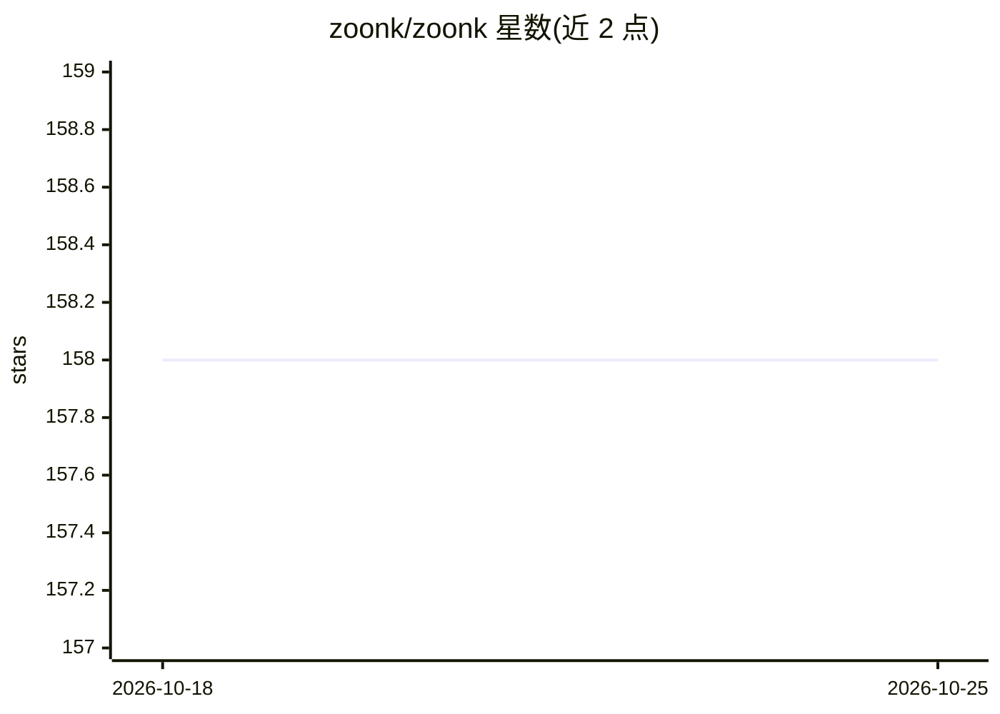

# zoonk/zoonk

⭐ 158 · TypeScript · MIT · 推送 2026-10-18 · [GitHub](https://github.com/zoonk/zoonk) · [官网](https://zoonk.com) · 组织维护

**把个人目标转成每日学习计划的学习平台**

Zoonk 是一个面向学习者的开源平台：用户用自己的话描述目标，系统按截止日期规划每天的课程、练习与复习内容。技术栈为 Next.js monorepo，使用 Prisma 与 PostgreSQL，主题标签显示集成 Vercel AI SDK 与 better-auth。自部署需 Node.js v24、pnpm v12、PostgreSQL v18，通过 pnpm 命令安装依赖与启动开发环境，支持多应用并行开发、Git worktree 隔离数据库与 i18n 翻译流程。README 未展示 AI 生成的具体机制细节。

## 筛选速览

| 维度 | 判定 | 备注 |
|---|---|---|
| AI 角色 | `ai-native` | 本体是模型或模型工具 |
| 许可风险 | `permissive` | MIT |
| 部署形态 | `library` | 以包/库形式分发 |
| 模型依赖 | — | README 未给出锁定关系 |
| 硬件要求 | — | 无带数字的原话,不猜 |
| 安装摩擦 | `low` | 无编译、无系统依赖或容器化 |
| 成熟度 | — | 结构信号不足 |

## 能力要点

- 以自然语言输入目标，生成含课程、练习、复习的每日计划
- Next.js + Prisma + PostgreSQL monorepo，含 lint/typecheck/单测/E2E 完整工程链
- Portless 多应用本地开发与 Git worktree 隔离开发/测试数据库

## 适用场景

- 为考试或截止日期制定逐日推进的学习计划
- 自部署并二次开发一个学习规划平台

## 场景标签

 · 领域:教育科技

## 证据(README 行号)

> L1: Zoonk logo next to the text: Turn your goal into a daily learning plan.
> L3:  Tell us your goal in your own words. Zoonk plans every day until your date, with lessons, practice and reviews shap

## 星数曲线

2026-10-18 158 → 2026-10-25 158（+0）

---
*卡片 v1 · prompt 1.4 · 生成 2026-10-22 · 置信度 low · 依据 README sha `7f806c9a0ee3` · [字段定义](../../DATASET.md)*
