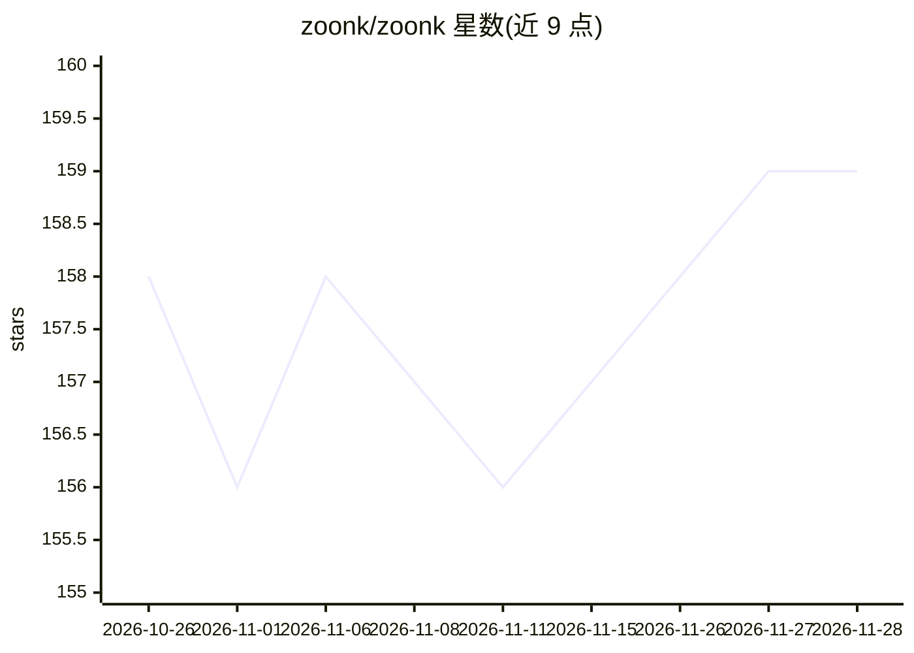

# zoonk/zoonk

⭐ 159 · TypeScript · MIT · 推送 2026-11-27 · [GitHub](https://github.com/zoonk/zoonk) · [官网](https://zoonk.com) · 组织维护

**输入学习目标，AI 生成每日学习计划的应用**

用户用自己的话描述目标，应用据此生成到目标日期为止的每日学习计划，包含课程、练习与复习内容，生成过程经 AI Gateway 完成。代码为多应用 monorepo（main 与 api 两个 app），本地开发依赖 Node.js、pnpm 与本机 PostgreSQL；未配置的服务保持关闭，无需强制环境变量，但生成类功能需接入 Zoonk 的 Vercel 团队或自行设置 AI Gateway API key。提供本地开发、生产构建、测试、i18n 等完整脚本。

## 筛选速览

| 维度 | 判定 | 备注 |
|---|---|---|
| AI 角色 | `ai-native` | 本体是模型或模型工具 |
| 许可风险 | `permissive` | MIT |
| 部署形态 | `library` | 以包/库形式分发 |
| 模型依赖 | — | README 未给出锁定关系 |
| 硬件要求 | — | 无带数字的原话,不猜 |
| 安装摩擦 | `low` | 无编译、无系统依赖或容器化 |
| 成熟度 | — | 结构信号不足 |

## 能力要点

- 自然语言输入目标，生成带课程、练习与复习的逐日计划
- 计划与课程生成走 Vercel AI Gateway
- 无需环境变量即可启动本地开发，未配置服务自动关闭
- 内置 Vitest/Playwright 测试、i18n 翻译与 lint 脚本

## 适用场景

- 为备考或技能学习制定每日学习计划
- 按目标日期安排课程、练习与复习节奏
- 自托管部署一套个人学习计划应用

## 场景标签

 · 领域:教育/学习工具

## 证据(README 行号)

> L3:  Tell us your goal in your own words. Zoonk plans every day until your date, with lessons, practice and reviews shap
> L25: No environment variable is required: the apps use local defaults, sign-in codes land in the local mailbox, and serv

## 星数曲线

2026-10-26 158 → 2026-11-28 159（+1）

---
*卡片 v1 · prompt 1.4 · 生成 2026-11-27 · 置信度 mid · 依据 README sha `be32f83b75ce` · [字段定义](../../DATASET.md)*
