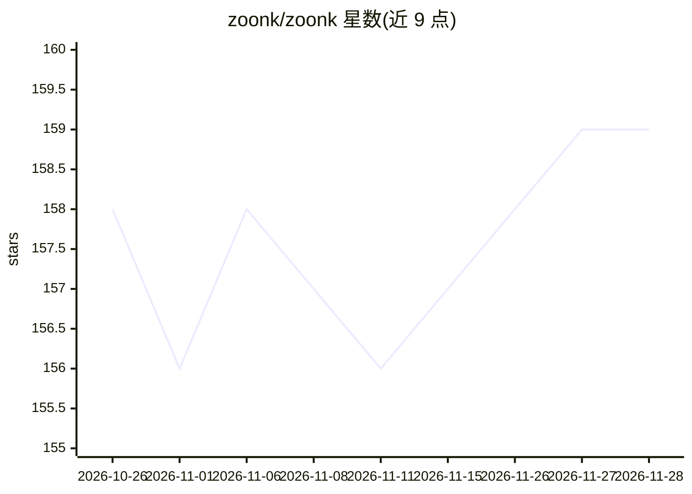

# zoonk/zoonk

⭐ 159 · TypeScript · MIT · 推送 2026-11-27 · [GitHub](https://github.com/zoonk/zoonk) · [官网](https://zoonk.com) · 组织维护

**把学习目标变成每日学习计划的教育应用**

Zoonk 是一个 Web 应用：用户用自己的话描述学习目标，应用按截止日期生成每日计划，包含课程（lessons）、练习（practice）与复习（reviews）。技术栈为 Next.js + Prisma + PostgreSQL，采用 pnpm monorepo 多应用结构，认证使用登录码（本地开发时验证码落入本地邮箱）。计划与课程的生成通过 Vercel AI Gateway，可用自己的 AI_GATEWAY_API_KEY 或 Vercel 团队接入；未配置的服务默认关闭，无需环境变量即可本地启动。

## 筛选速览

| 维度 | 判定 | 备注 |
|---|---|---|
| AI 角色 | `ai-native` | 本体是模型或模型工具 |
| 许可风险 | `permissive` | MIT |
| 部署形态 | `library` | 以包/库形式分发 |
| 模型依赖 | — | README 未给出锁定关系 |
| 硬件要求 | — | 无带数字的原话,不猜 |
| 安装摩擦 | `low` | 无编译、无系统依赖或容器化 |
| 成熟度 | — | 结构信号不足 |

## 能力要点

- 以自然语言输入目标生成带截止日期的每日学习计划
- 生成类功能统一走 Vercel AI Gateway，支持自带 API key
- pnpm monorepo 多应用结构，Portless 管理本地多 URL 与 LAN HTTPS 测试
- 内置 Vitest、Playwright E2E、i18n lint 与 TypeScript 检查工作流

## 适用场景

- 给自己设定一个学习目标并获得每日课程、练习和复习安排
- 在手机等设备上通过 LAN HTTPS 环境测试应用
- 参与该项目贡献并运行完整的本地开发与测试流程

## 场景标签

 · 领域:教育/学习工具

## 证据(README 行号)

> L1: Zoonk logo next to the text: Turn your goal into a daily learning plan.
> L3:  Tell us your goal in your own words. Zoonk plans every day until your date, with lessons, practice and reviews shap
> L25: No environment variable is required: the apps use local defaults, sign-in codes land in the local mailbox, and serv

## 星数曲线

2026-10-26 158 → 2026-11-28 159（+1）

---
*卡片 v1 · prompt 1.4 · 生成 2026-11-28 · 置信度 mid · 依据 README sha `e757f643d449` · [字段定义](../../DATASET.md)*
