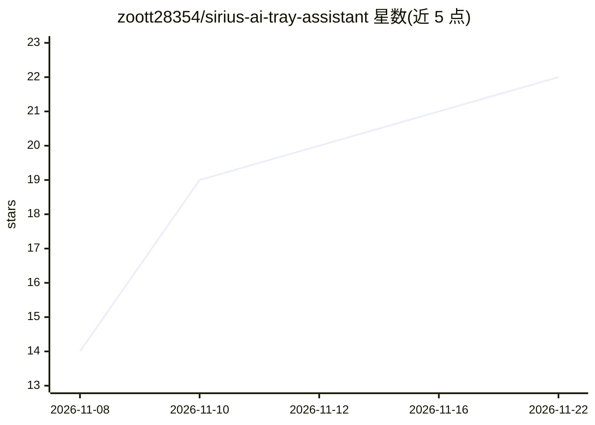

# zoott28354/sirius-ai-tray-assistant

⭐ 22 · Python · GPL-3.0 · 推送 2026-04-23 · [GitHub](https://github.com/zoott28354/sirius-ai-tray-assistant) · 个人维护 · 中文 README

**Windows 托盘常驻的本地 AI 助手：截图翻译、图像分析与持久对话**

面向 Windows 桌面的本地优先 AI 助手，常驻系统托盘，提供屏幕区域截取分析、剪贴板文本翻译与分析、图像/PDF/DOCX 附件随聊处理，会话历史持久化在 SQLite 中可随时续聊。支持 Ollama、LM Studio、Llama.cpp、Llama-Swap 及任意 OpenAI 兼容端点作为本地后端，可连接局域网内其他机器运行的后端。通过 Releases 提供安装包，也可从源码用 setup.bat 运行；上下文长度与生成参数由所选后端管理，应用不覆盖这些限制。

## 筛选速览

| 维度 | 判定 | 备注 |
|---|---|---|
| AI 角色 | `ai-native` | 本体是模型或模型工具 |
| 许可风险 | `viral` | GPL-3.0 |
| 部署形态 | `desktop` | 安装包/桌面程序 |
| 模型依赖 | local-ok | 支持本地模型 |
| 硬件要求 | — | 无带数字的原话,不猜 |
| 安装摩擦 | `low` | 无编译、无系统依赖或容器化 |
| 成熟度 | — | 结构信号不足 |

## 能力要点

- 托盘一键截屏区域分析、剪贴板文本分析，均为本地后端处理
- 支持 Ollama/LM Studio/Llama.cpp/Llama-Swap/OpenAI 兼容多后端及局域网连接
- SQLite 持久会话历史，支持导出为 Obsidian 友好 ZIP 或 PDF
- 扫描版 PDF 渲染为页图送视觉/OCR 模型，支持 9 种界面语言

## 适用场景

- 在托盘随时截屏让本地模型解释屏幕上的报错
- 复制外语文本一键翻译并继续追问
- 把截图和 PDF 附件发进对话让本地多模态模型分析
- 在局域网另一台电脑运行 Ollama，桌面端远程调用

## 场景标签

`AI 助手` `多模态` · 领域:对话与助手

## 证据(README 行号)

> L9: Sirius AI Tray Assistant is a local desktop companion for Windows built for real day-to-day use: capture part of the
> L26: - 🤖 Multiple local backends are supported: Ollama, LM Studio, Llama.cpp, Llama-Swap, and generic OpenAI-compatible 
> L93: ## 🤖 Supported backends

## 星数曲线

2026-11-08 14 → 2026-11-22 22（+8）

---
*卡片 v1 · prompt 1.4 · 生成 2026-11-18 · 置信度 mid · 依据 README sha `6e8d04ce710d` · [字段定义](../../DATASET.md)*
