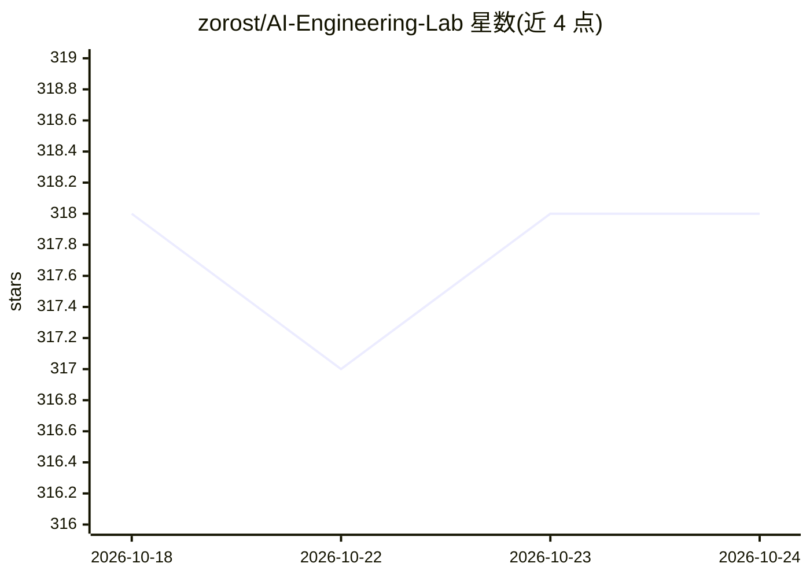

# zorost/AI-Engineering-Lab

⭐ 318 · Jupyter Notebook · MIT · 推送 2026-08-17 · [GitHub](https://github.com/zorost/AI-Engineering-Lab) · [官网](https://zorost.com/ai-engineering-lab) · 组织维护

**24 周 AI 工程自学课程：从 Python 到 LLM、Agent 与云平台**

由 Zorost Intelligence AI Lab 开发的免费自学 AI 工程训练课程，覆盖 Python、机器学习与深度学习、LLM 内部机制、提示与上下文工程、RAG 向量检索、量化、LoRA/DPO 微调、评测、AI Agent 与 MCP、Azure/Vertex/Bedrock 云平台以及 Databricks 湖仓。面向想转型 AI 工程师的开发者、分析师与学生；每周包含可运行 notebook、一个贯穿 24 周的虚构货运公司案例、指标与错误分析。MIT 许可，无需注册，前 13 周有免 GPU、免付费 API 的路径。

## 筛选速览

| 维度 | 判定 | 备注 |
|---|---|---|
| AI 角色 | `ai-knowledge` | 知识聚合/清单类 |
| 许可风险 | `permissive` | MIT |
| 部署形态 | `library` | 以包/库形式分发 |
| 模型依赖 | — | README 未给出锁定关系 |
| 硬件要求 | — | 无带数字的原话,不猜 |
| 安装摩擦 | `low` | 无编译、无系统依赖或容器化 |
| 成熟度 | — | 结构信号不足 |

## 能力要点

- 24 周、7 阶段课程结构，43 个可运行 notebook（Python/SQL/PySpark）
- 单一贯穿案例（ZoroLogistics 货运公司）串联全部周内容
- 前 8 周无需 GPU，前 13 周有本地模型/免费 API 路径
- 实现 Andrew Ng AI 工程技能图与三个循环（非官方关联）

## 适用场景

- 从零基础系统转行 AI 工程并积累作品集
- 在职开发者补齐 LLM、微调、Agent 与 MCP 的工程实践
- 企业在 Databricks 现代化前培训工程师

## 场景标签

 · 领域:AI 工程教育

## 证据(README 行号)

> L38: AI Engineering Lab is a free AI engineering course: an open, self-paced **training program** that
> L42: evaluation harnesses, coding-agent harnesses, AI agents and the Model Context Protocol, Azure AI

## 星数曲线

2026-10-18 318 → 2026-10-24 318（+0）

---
*卡片 v1 · prompt 1.4 · 生成 2026-10-21 · 置信度 high · 依据 README sha `cdae42c76f84` · [字段定义](../../DATASET.md)*
