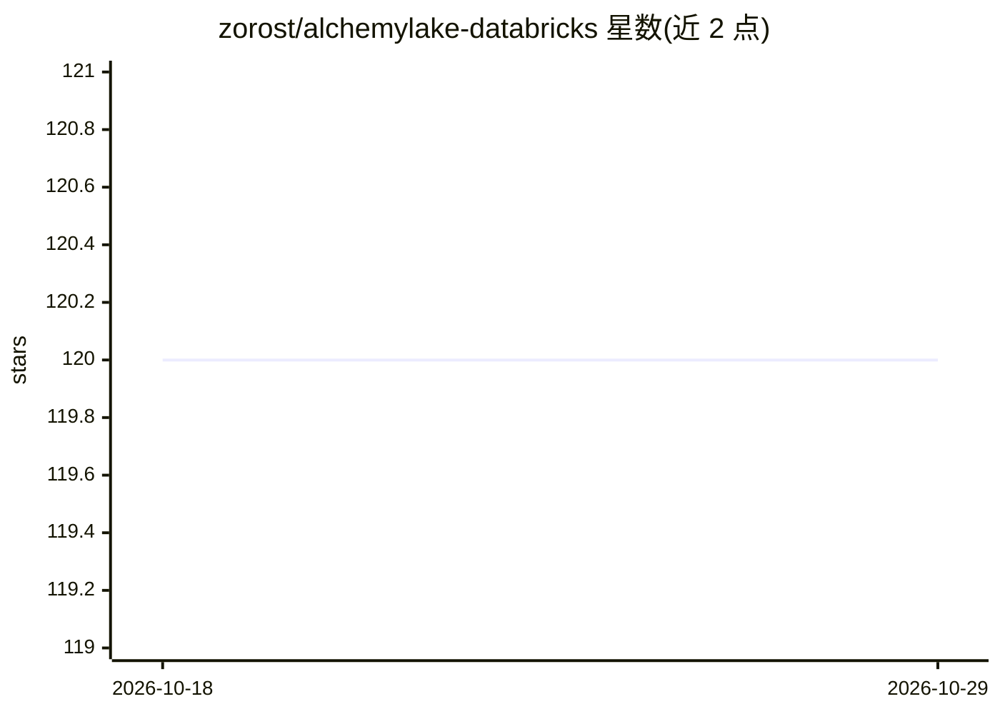

# zorost/alchemylake-databricks

⭐ 120 · Python · Apache-2.0 · 推送 2026-07-09 · [GitHub](https://github.com/zorost/alchemylake-databricks) · [官网](https://app.alchemylake.com) · 组织维护

**把 Databricks 治理数据生成为封印溯源的汇报物（deck/PDF/视频/播客）**

以 Databricks Asset Bundle 形式部署的 Streamlit App，作为薄客户端通过 MCP/HTTPS 调用 AlchemyLake 平台，将 Unity Catalog 表、Genie 回答或上传文件等治理数据源渲染为 PowerPoint、PDF 报告+Excel 证据簿、信息图、带旁白视频简报、双主持人播客与数据配乐。核心机制：数字由代码从绑定行计算、生成后逐条核验主张，并将溯源封印（来源·行数·数据哈希·验证分）嵌入输出文件。另提供 13 个 MCP 工具、SQL 函数 ai_render() 与 npx CLI 三种使用路径；需 Databricks Apps（Premium/Enterprise）与平台开发者 key，新用户赠送 50 积分。

## 筛选速览

| 维度 | 判定 | 备注 |
|---|---|---|
| AI 角色 | `ai-native` | 本体是模型或模型工具 |
| 许可风险 | `permissive` | Apache-2.0 |
| 部署形态 | `library` | 以包/库形式分发 |
| 模型依赖 | — | README 未给出锁定关系 |
| 硬件要求 | — | 无带数字的原话,不猜 |
| 安装摩擦 | `low` | 无编译、无系统依赖或容器化 |
| 成熟度 | — | 结构信号不足 |

## 能力要点

- 8 种输出形态：deck/PDF 报告/深度研究档案/信息图/视频/播客/配乐等
- 数字由代码计算而非模型生成，生成后逐条核验并封印溯源（来源·行数·哈希·验证分）
- 13 个 MCP 治理工具供 Genie/Agent Bricks 调用，另有 ai_render() SQL 函数与 npx CLI
- 数据不离开 lakehouse，仅绑定的具体行用于单次渲染

## 适用场景

- 把季度经营数据一键渲染成可直接汇报的董事会 deck 与 PDF 报告
- 让 Genie/Agent 在对话中生成带证据工作簿的深度研究档案
- 将周报数据制成带旁白的视频简报或双主持人播客供通勤收听

## 场景标签

`数据分析` · 领域:效率与自动化

## 证据(README 行号)

> L62: This repository **is** a self-contained **Databricks Asset Bundle**. One command
> L81: |**2. MCP for Genie / Agent Bricks**|Every agent gains **13 governed tools** (`list_governed_sources`, `upload_sour
> L122: AlchemyLake never runs *inside* this bundle — the App is a thin, SSO'd client that

## 星数曲线

2026-10-18 120 → 2026-10-29 120（+0）

---
*卡片 v1 · prompt 1.4 · 生成 2026-10-23 · 置信度 high · 依据 README sha `0444de482953` · [字段定义](../../DATASET.md)*
