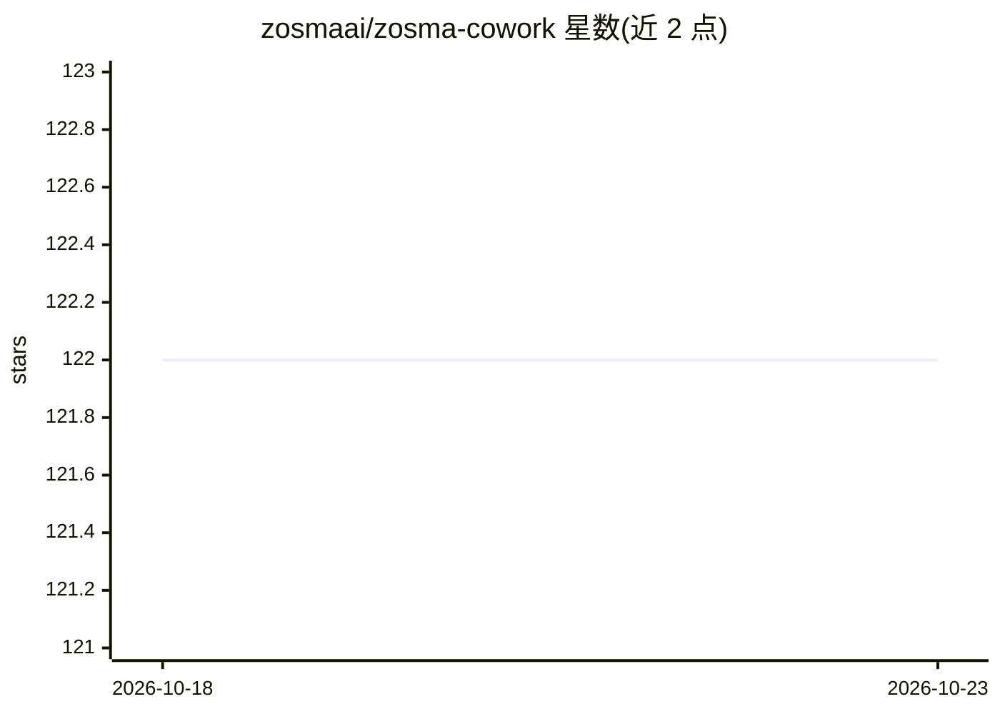

# zosmaai/zosma-cowork

⭐ 122 · TypeScript · MIT · 推送 2026-10-17 · [GitHub](https://github.com/zosmaai/zosma-cowork) · [官网](https://www.zosma.ai/zosma-cowork) · 组织维护

**面向团队的开源 AI 工作平台：跨机器运行与监督 AI agent**

MIT 许可的 work-focused AI agent 平台，供个人、小团队与企业在一个工作区委派任务、监督长时运行的 agent、审批敏感操作并收集结果。当前发布形态为本地 Pi 驱动的 Web 应用加 Tauri 桌面壳，提供持久会话、流式输出、工具、文件、Git 支持、扩展与模型配置；机器守护进程、控制平面、移动端与更多 harness 适配器仍在规划中。自带 Docker 单机与 fleet 控制平面部署（实验性），计划支持 Claude Code、Codex 等 harness 适配。

## 筛选速览

| 维度 | 判定 | 备注 |
|---|---|---|
| AI 角色 | `ai-ecosystem` | LLM/agent 周边工具 |
| 许可风险 | `permissive` | MIT |
| 部署形态 | `self-host` | docker 或自建部署 |
| 模型依赖 | — | README 未给出锁定关系 |
| 硬件要求 | — | 无带数字的原话,不猜 |
| 安装摩擦 | `low` | 无编译、无系统依赖或容器化 |
| 成熟度 | `idea` | |

## 能力要点

- 本地 Pi 运行时为 first-class，含会话树、流式、工具、Git/worktree 与扩展
- 规划中的 TypeScript 机器守护进程与控制平面：出站连接、审批、策略执行
- 实验性 Docker 单机与 fleet 模式（多守护进程经控制平面调度）
- 跨平台桌面打包与 local-first 运行

## 适用场景

- 团队在同一工作区委派并监督多个 AI agent 的长时任务
- 对敏感操作设置审批与策略，保持凭据在本地机器
- 在自有基础设施上自托管 AI 工作平台

## 场景标签

 · 领域:AI agent 平台/开发者工具

## 证据(README 行号)

> L18: Zosma Cowork is an **MIT-licensed, work-focused AI agent platform**. It gives people and teams one place to delegat
> L82: |Pi|Native TypeScript SDK|✅ First-class runtime; backend extraction and `/api/v1` read slice shipped|

## 星数曲线

2026-10-18 122 → 2026-10-23 122（+0）

---
*卡片 v1 · prompt 1.4 · 生成 2026-10-23 · 置信度 high · 依据 README sha `0a5c7c9c273d` · [字段定义](../../DATASET.md)*
