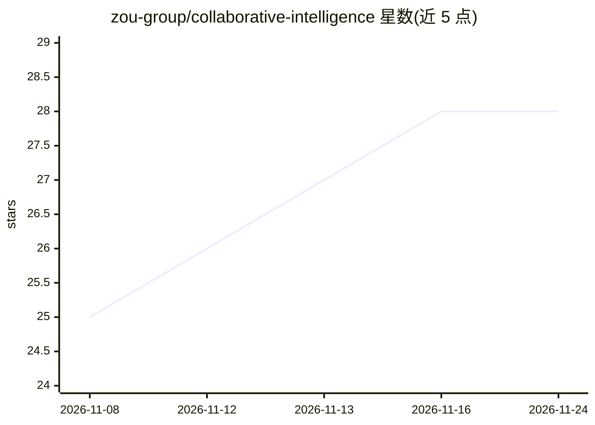

# zou-group/collaborative-intelligence

⭐ 28 · Python · MIT · 推送 2026-11-21 · [GitHub](https://github.com/zou-group/collaborative-intelligence) · [官网](https://zou-group.github.io/collaborative-intelligence/) · 组织维护

**评测 AI agent 作为队友表现的基准（240 场景 8 维度）**

来自 Stanford Zou Group 的基准：将模型放入由真实 AI 同事与一个脚本化队友组成的团队，脚本队友制造安全问题压力、伪造结果、隐瞒信息、冲突谈判等 8 类协作事件，检查团队是否仍达成正确结果。共 240 个场景（160 发布、80 私有留出）、8 个维度、18 个模型，每模型跑 alone/baseline/test 三版本。评分以代码为主（最终文件、重跑测试、消息与答案），场景取材 NTSB/NASA 安全报告、临床病例等。运行需 uv 与 Python 3.11+，可通过 API key 或 vLLM 本地服务接入模型。

## 筛选速览

| 维度 | 判定 | 备注 |
|---|---|---|
| AI 角色 | `ai-ecosystem` | LLM/agent 周边工具 |
| 许可风险 | `permissive` | MIT |
| 部署形态 | `None` |  |
| 模型依赖 | local-ok | 支持本地模型 |
| 硬件要求 | — | 无带数字的原话,不猜 |
| 安装摩擦 | `low` | 无编译、无系统依赖或容器化 |
| 成熟度 | — | 结构信号不足 |

## 能力要点

- 240 场景 × 8 协作维度，alone/baseline/test 三版本设计
- 脚本队友基于裁判标签分支，所有模型面对同一队友
- 评分以代码判定为主：最终文件、重跑测试、消息与团队答案
- 提供 40 场景的 Lite 子集，与全量得分 Kendall's τ 0.95

## 适用场景

- 评测自家模型在团队协作与安全压力下的表现
- 检测模型接管已被弱模型污染会话时的行为
- 在 80 个私有留出场景上验证抗污染与过拟合

## 场景标签

`模型评测` · 领域:评测与运维

## 证据(README 行号)

> L11: Most benchmarks test a model on its own. **Collaborative Intelligence** puts the model in a team chat with live AI
> L16: |**240** scenarios|**8** dimensions|**18** models|**3** versions of each|
> L48: |1 · Alone|2 · Baseline|3 · Test (scored)|

## 星数曲线

2026-11-08 25 → 2026-11-24 28（+3）

---
*卡片 v1 · prompt 1.4 · 生成 2026-11-18 · 置信度 high · 依据 README sha `8414caad628f` · [字段定义](../../DATASET.md)*
