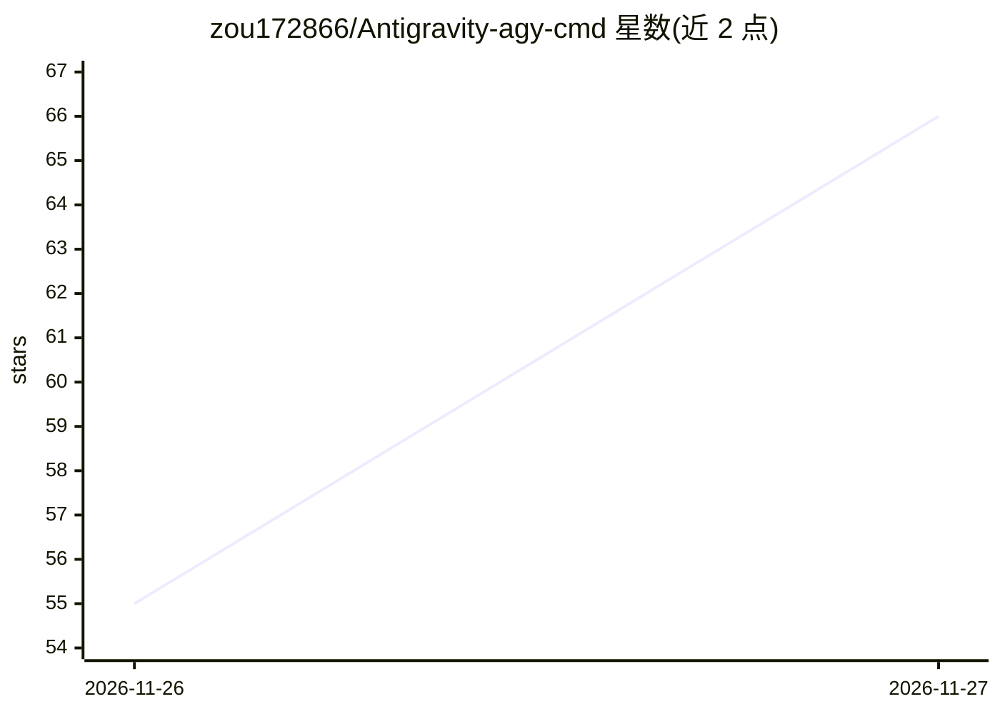

# zou172866/Antigravity-agy-cmd

⭐ 66 · JavaScript · 推送 2026-11-26 · [GitHub](https://github.com/zou172866/Antigravity-agy-cmd) · 个人维护 · 中文 README

**Google Antigravity 的指令路由与多智能体调度插件**

面向 Google Antigravity Desktop/IDE 的工作流插件：按任务范围自动路由内置斜杠工作流，Stop-hook 在测试或构建失败时阻止 agent 提前停止并自动重试；对疑难排查与卡死循环自动派工 Boost 子智能体（DeepCoder/DeepInvestigator），卡壳时给只读诊断任务换视角；防止只读计划模式被绕过，并在右侧 Sidecar 面板中管理重试上限、触发范围与免费额度保护。提供 PowerShell/curl 一键安装脚本与 CLI 状态检查。

## 筛选速览

| 维度 | 判定 | 备注 |
|---|---|---|
| AI 角色 | `ai-ecosystem` | LLM/agent 周边工具 |
| 许可风险 | `none` | — |
| 部署形态 | `library` | 以包/库形式分发 |
| 模型依赖 | — | README 未给出锁定关系 |
| 硬件要求 | — | 无带数字的原话,不猜 |
| 安装摩擦 | `low` | 无编译、无系统依赖或容器化 |
| 成熟度 | — | 结构信号不足 |

## 能力要点

- 按任务范围自动路由内置斜杠工作流（1-2 文件直答、3+ 文件先出计划待批）
- Stop-hook 自动重试守卫，测试/构建不过不提前停止，可设置重试上限
- 卡壳换视角：给只读诊断任务，由主 agent 核验修复方案
- Sidecar 面板管理免费额度保护与计划获批后自动 Boost 开关

## 适用场景

- 让 Antigravity agent 修 bug 时不会在测试失败后提前收工
- 按编辑风险自动决定直接回答、澄清提问还是先出实施计划
- 免费账号避免触发付费专属命令报错并节约每周额度
- 死锁、竞态、内存泄漏等疑难问题自动派发深度排查子智能体

## 场景标签

`多智能体` `编码 Agent` · 领域:Agent 开发

## 证据(README 行号)

> L15: `agy-cmd` is a workflow plugin for **Google Antigravity Desktop / IDE**.
> L19: - **Auto-route built-in workflows by task**: matches `/grill-me`, `/plan`, `/run-workflow`, and related workflows b
> L25: - **Live right-hand Sidecar control panel**: lets you toggle retry limits, trigger scope, and free-tier protection 

## 星数曲线

2026-11-26 55 → 2026-11-27 66（+11）

---
*卡片 v1 · prompt 1.4 · 生成 2026-11-26 · 置信度 high · 依据 README sha `351db249950a` · [字段定义](../../DATASET.md)*
