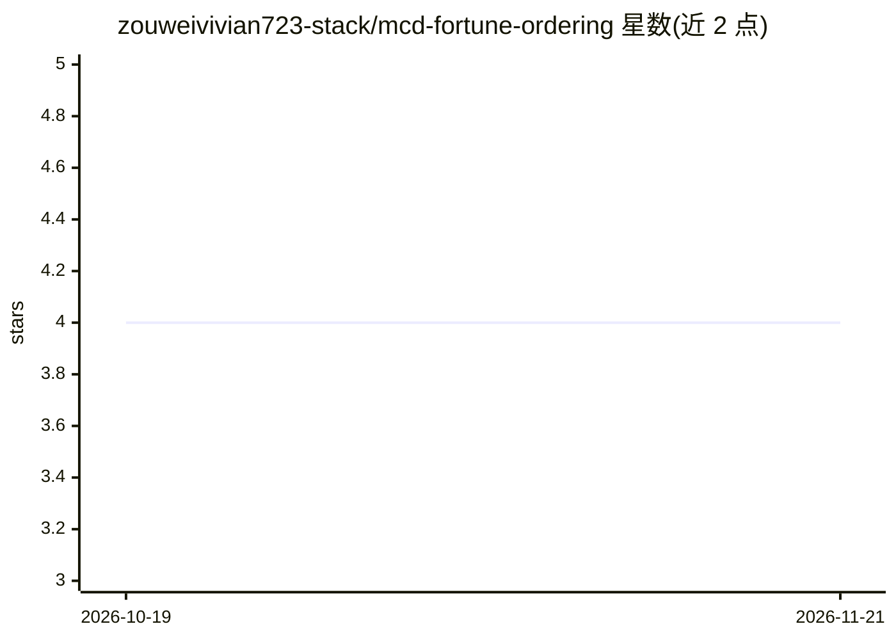

# zouweivivian723-stack/mcd-fortune-ordering

⭐ 4 · HTML · 推送 2026-10-12 · [GitHub](https://github.com/zouweivivian723-stack/mcd-fortune-ordering) · 个人维护 · 中文 README

**预算输入抽签式搭配麦当劳套餐并生成运势解读的技能**

基于麦当劳 MCP 能力开发的创意 Skill：用户输入预算金额，系统调用门店查询、餐品列表、优惠券、价格计算等 5 个麦当劳 MCP 工具，在预算内随机搭配套餐，并生成签号、宜忌、财运/桃花运/事业运星级、幸运色、幸运数字与签文解语等运势解读。可在 WorkBuddy 中作为连接器对话使用，也可本地用 Python 3.8+ 运行（仅标准库）；另提供纯前端可视化抽签卡片页面，含摇签动画、音效与图片导出。

## 筛选速览

| 维度 | 判定 | 备注 |
|---|---|---|
| AI 角色 | `ai-native` | 本体是模型或模型工具 |
| 许可风险 | `permissive` | — |
| 部署形态 | `None` |  |
| 模型依赖 | — | README 未给出锁定关系 |
| 硬件要求 | — | 无带数字的原话,不猜 |
| 安装摩擦 | `low` | 无编译、无系统依赖或容器化 |
| 成熟度 | — | 结构信号不足 |

## 能力要点

- 调用 5 个麦当劳 MCP 工具完成门店查询、餐品、优惠券与价格计算
- 预算感知搭配策略（<20 元小食为主到 50 元+丰富组合的分档规则）
- 40+ 餐品运势模板组合生成签文
- 纯前端可视化抽签卡片，含 Web Audio 音效与 html2canvas 图片导出

## 适用场景

- 输入预算让系统随机搭配一份麦当劳套餐
- 在 WorkBuddy 对话里抽一签获得运势解读
- 导出抽签卡片分享到朋友圈

## 场景标签

`聊天机器人` · 领域:对话与助手

## 证据(README 行号)

> L15: **麦门抽签** 是一个基于麦当劳 MCP（Model Context Protocol）能力开发的创意 Skill，将麦当劳点餐与中国传统抽签文化巧妙结合。
> L21: 3. 为搭配结果生成一份有趣的"运势解读"——签号、宜忌、财运/桃花运/事业运星级、幸运色、幸运数字、签文解语
> L127: - **MCP 全链路调用**：门店查询 → 餐品列表 → 优惠券 → 价格计算，真实使用 5 个麦当劳 MCP 工具

## 星数曲线

2026-10-19 4 → 2026-11-21 4（+0）

---
*卡片 v1 · prompt 1.4 · 生成 2026-11-21 · 置信度 high · 依据 README sha `6ef5624e6d5d` · [字段定义](../../DATASET.md)*
