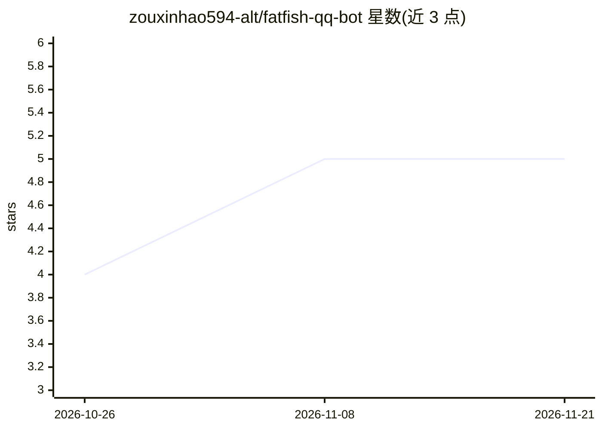

# zouxinhao594-alt/fatfish-qq-bot

⭐ 5 · JavaScript · MIT · 推送 2026-11-16 · [GitHub](https://github.com/zouxinhao594-alt/fatfish-qq-bot) · 个人维护 · 中文 README

**QQ 群里的本地 AI 陪伴机器人：聊天、唱歌、写日记**

基于 Node.js 单进程的 QQ 机器人，通过 OneBot11 网关（SnowLuma/NapCat）接入 QQ，实现拟人化聊天（分条发送、相关性打分、静默时段）、长期记忆、本地克隆音色语音、点歌翻唱（Demucs 分离 + RVC 换声）与每日自动发 QQ 空间日记。带本地网页控制台配置模型、人格与音色。零 npm 依赖，Windows 10/11 上运行，语音与唱歌需自行部署 GPT-SoVITS、RVC、Demucs 等本地服务；公开版不含远程控制手机与个人素材。

## 筛选速览

| 维度 | 判定 | 备注 |
|---|---|---|
| AI 角色 | `ai-native` | 本体是模型或模型工具 |
| 许可风险 | `permissive` | MIT |
| 部署形态 | `desktop` | 安装包/桌面程序 |
| 模型依赖 | — | README 未给出锁定关系 |
| 硬件要求 | — | 无带数字的原话,不猜 |
| 安装摩擦 | `medium` | 含编译或系统依赖之一 |
| 成熟度 | — | 结构信号不足 |

## 能力要点

- 拟人聊天机制：长句拆条、相关性打分决定是否接话、静默时段与频率限制
- 本地音色克隆（GPT-SoVITS api_v2 零样本）与 RVC 翻唱点歌链路
- 每日第一人称日记自动发 QQ 空间说说（需 SnowLuma 扩展动作）
- 本地网页控制台配置全部参数，全部数据留在本机

## 适用场景

- 给个人 QQ 小号部署一个会聊天会唱歌的陪伴机器人
- 在群里部署按白名单接话、有长期记忆的机器人
- 用参考音频克隆音色并让机器人用该声音说话唱歌

## 场景标签

`聊天机器人` · 领域:对话与助手

## 证据(README 行号)

> L1: # 大肥鱼 · QQ 陪伴机器人
> L3: 一个把自己"当成群里的人"来聊天的小机器人：会接话、会撒娇、会用她自己的声音说话、会唱歌、会偷表情包，还会每天写一篇自己的日记发到 QQ 空间。带一个本地网页控制台，所有设置点一下就能改，改完立即生效。
> L64: QQ 客户端 ── OneBot11 网关（SnowLuma / NapCat 等）──正向 WebSocket──▶ 本程序

## 星数曲线

2026-10-26 4 → 2026-11-21 5（+1）

---
*卡片 v1 · prompt 1.4 · 生成 2026-11-20 · 置信度 mid · 依据 README sha `87bfd274b7a6` · [字段定义](../../DATASET.md)*
