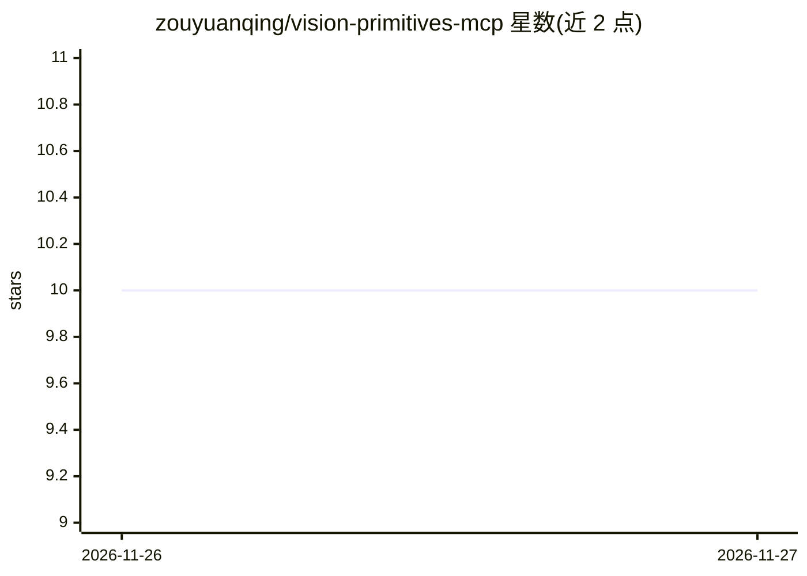

# zouyuanqing/vision-primitives-mcp

⭐ 10 · Python · MIT · 推送 2026-08-05 · [GitHub](https://github.com/zouyuanqing/vision-primitives-mcp) · 个人维护 · 中文 README

**给纯文本 LLM 提供视觉能力的 MCP 服务器**

单文件 Python 的 MCP 服务器，通过 stdio JSON-RPC 2.0 向纯文本模型暴露 30 个视觉工具：图像描述、坐标定位、带 bbox 的 OCR、标注、裁切放大、异常扫描、UI 结构化、多轮视觉推理与屏幕控制。视觉后端可切换（MiMo V2.5 云端 / LM Studio 本地 Qwen2.5-VL 等），核心仅依赖 Pillow，YOLO/CRAFT 检测器为可选加速件。屏幕控制 8 个工具仅支持 Windows 且默认关闭，配置经 MCP 客户端 toml 接入。

## 筛选速览

| 维度 | 判定 | 备注 |
|---|---|---|
| AI 角色 | `ai-ecosystem` | LLM/agent 周边工具 |
| 许可风险 | `permissive` | MIT |
| 部署形态 | `library` | 以包/库形式分发 |
| 模型依赖 | — | README 未给出锁定关系 |
| 硬件要求 | — | 无带数字的原话,不猜 |
| 安装摩擦 | `low` | 无编译、无系统依赖或容器化 |
| 成熟度 | — | 结构信号不足 |

## 能力要点

- 30 个 MCP 工具覆盖描述/定位/OCR/标注/裁切/扫描/UI 结构化
- 视觉后端可切换：云端 MiMo V2.5 或 LM Studio 本地 Qwen2.5-VL
- som_locate/text_zoom 等工具基于粗定位→裁切→精定位管线
- URL 图片含 SSRF 防护与 50MP 解压限制，屏幕控制默认拒绝

## 适用场景

- 让 DeepSeek、Codex 等纯文本模型通过 MCP 客户端读图、定位、OCR
- 桌面 GUI 自动化中的元素定位与截屏点击
- PCB 等图像的自动异常扫描
- arXiv/PDF 论文的多屏截图分块阅读与结构化摘要

## 场景标签

`GUI 自动化` `OCR` `图像视频处理` · 领域:效率与自动化

## 证据(README 行号)

> L5: 让纯文本模型（DeepSeek / Codex / 任意 MCP 客户端）通过 **30 个 MCP 工具**获得完整视觉能力：**描述 → 定位（坐标）→ OCR → 标注 → 裁切/放大 → 异常扫描 → UI 结构化 → 多轮
> L7: > **项目定位**：通用视觉推理桥接层——文本模型 + **任意 VLM** 的通用视觉工作流，本地隐私 + 单文件轻量。**高泛化优先**：核心能力（定位/切块/放大/读取）全部是纯 VLM + PIL，专用检测器（YOLO/C
> L11:     │  MCP 协议（stdio, JSON-RPC 2.0）

## 星数曲线

2026-11-26 10 → 2026-11-27 10（+0）

---
*卡片 v1 · prompt 1.4 · 生成 2026-11-26 · 置信度 mid · 依据 README sha `63bfbd245604` · [字段定义](../../DATASET.md)*
