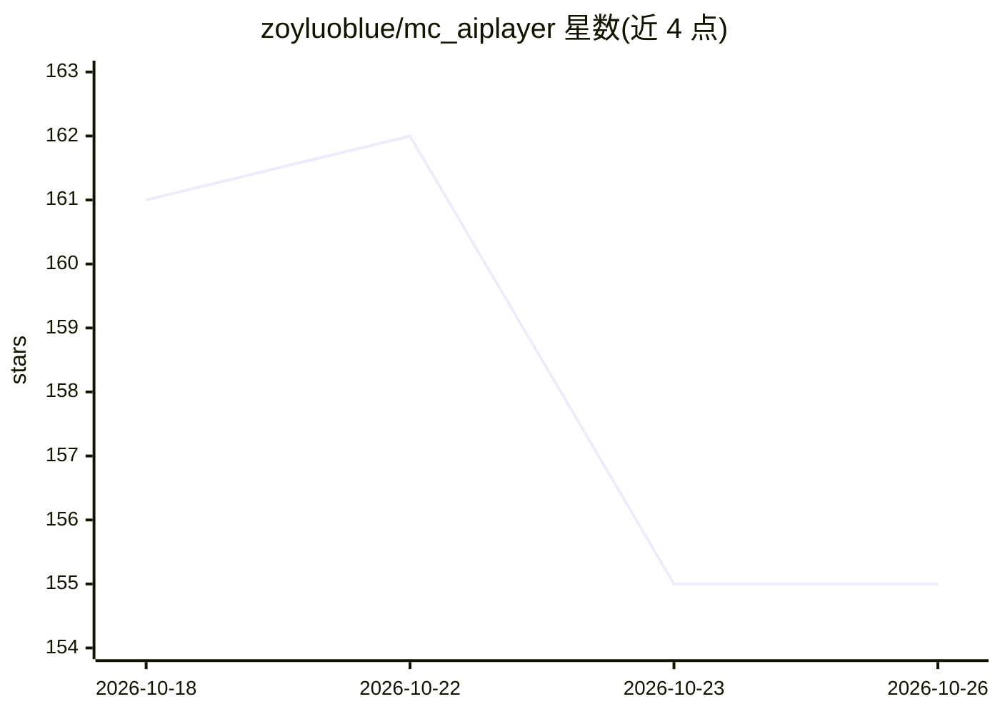

# zoyluoblue/mc_aiplayer

⭐ 155 · Java · MIT · 推送 2026-09-02 · [GitHub](https://github.com/zoyluoblue/mc_aiplayer) · [官网](https://github.com/zoyluoblue/mc_aiplayer/wiki) · 个人维护 · 中文 README

**服务端 Fabric 模组：LLM 驱动的真实玩家在 Minecraft 中自主生存**

面向 Minecraft 1.21.3 的服务端 Fabric 模组：生成一个真实的服务端玩家 Bob，接受中英文自然语言指令，由 OpenAI 兼容端点（默认 DeepSeek）的 LLM 从 63 个工具中选择意图，再由 9 种 Goal 与 34 个 Task 状态机执行挖矿、建造、农耕、战斗等行为；模型不直接逐 tick 控制移动或改写世界。提供 strict_survival/operator 两种运行配置、快照持久化与重启恢复。需 Java 21、Fabric Loader，通过 Gradle 构建运行并配置 API key。已知限制：长距离导航与大规模任务未获发布级验证。

## 筛选速览

| 维度 | 判定 | 备注 |
|---|---|---|
| AI 角色 | `ai-native` | 本体是模型或模型工具 |
| 许可风险 | `permissive` | MIT |
| 部署形态 | `None` |  |
| 模型依赖 | locked-api |  |
| 硬件要求 | — | 无带数字的原话,不猜 |
| 安装摩擦 | `medium` | 含编译或系统依赖之一 |
| 成熟度 | `idea` | |

## 能力要点

- LLM 从 63 个工具中选择意图，34 个确定性 Task 状态机负责执行
- 创建服务端真实玩家，非 Mineflayer 账号或 Python 控制框架
- strict_survival / operator 双运行配置，无效配置回退到严格模式
- 版本化原子快照持久化与跨 JVM 重启恢复

## 适用场景

- 在 Fabric 服务器上用自然语言让 AI 玩家执行挖矿、建造、生存等目标
- 通过游戏内面板与命令管理 AI 玩家的任务与状态
- 研究生成式 LLM 规划与确定性执行结合的游戏 agent

## 场景标签

 · 领域:游戏/自主agent

## 证据(README 行号)

> L21: AIBot is an open-source server-side Fabric mod for Minecraft 1.21.3. It creates a real server-side player, accepts 
> L44:     U["Player: chat, command, or Bob panel"] --> B["Brain: OpenAI-compatible tool calls"]

## 星数曲线

2026-10-18 161 → 2026-10-26 155（-6）

---
*卡片 v1 · prompt 1.4 · 生成 2026-10-22 · 置信度 high · 依据 README sha `658411022ca6` · [字段定义](../../DATASET.md)*
