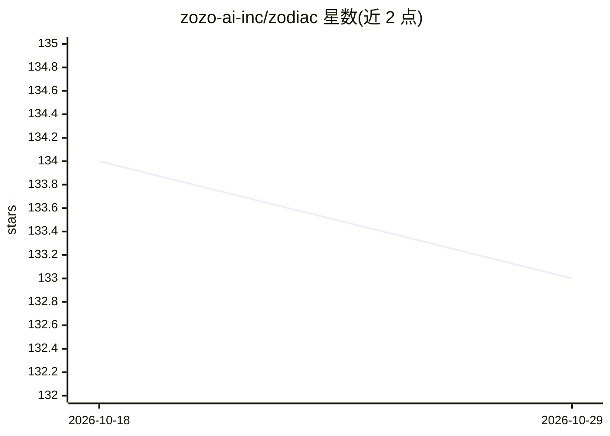

# zozo-ai-inc/zodiac

⭐ 133 · TypeScript · GPL-3.0 · 推送 2026-10-24 · [GitHub](https://github.com/zozo-ai-inc/zodiac) · [官网](https://chat.zozo.sh) · 组织维护

**面向创作者的 AI 角色扮演聊天前端，支持图像生成**

Zozo AI, Inc. 维护的网页聊天前端（原名 Zodiac），提供 AI 对话、自定义人设、角色扮演与图像生成编辑功能。对话模型经 OpenRouter 接入，可选配置 Gemini API key；托管图像生成与编辑使用 Runware。数据采用本地优先的浏览器存储，可选加密云同步。前端基于 Vite 与 TypeScript 构建，通过 git clone 与 npm 安装依赖后本地开发，GPL-3.0 许可。

## 筛选速览

| 维度 | 判定 | 备注 |
|---|---|---|
| AI 角色 | `ai-native` | 本体是模型或模型工具 |
| 许可风险 | `viral` | GPL-3.0 |
| 部署形态 | `library` | 以包/库形式分发 |
| 模型依赖 | locked-api |  |
| 硬件要求 | — | 无带数字的原话,不猜 |
| 安装摩擦 | `low` | 无编译、无系统依赖或容器化 |
| 成熟度 | — | 结构信号不足 |

## 能力要点

- AI 对话、自定义人设与角色扮演
- 图像生成与编辑（经 Runware 托管）
- 本地优先浏览器存储，可选加密云同步
- 对话模型经 OpenRouter 接入，可选 Gemini API key

## 适用场景

- 进行带人设的 AI 角色扮演对话
- 在浏览器本地保存聊天记录并可选云同步
- 在对话中生成与编辑图像

## 场景标签

`聊天机器人` `图像生成` · 领域:对话与助手

## 证据(README 行号)

> L3: AI for creatives, from **Zozo AI, Inc.** Formerly known as Zodiac.
> L5: Zozo Chat combines AI conversations, customizable personas, roleplay, and image generation and editing. It uses loca

## 星数曲线

2026-10-18 134 → 2026-10-29 133（-1）

---
*卡片 v1 · prompt 1.4 · 生成 2026-10-22 · 置信度 high · 依据 README sha `5252514fdb5f` · [字段定义](../../DATASET.md)*
