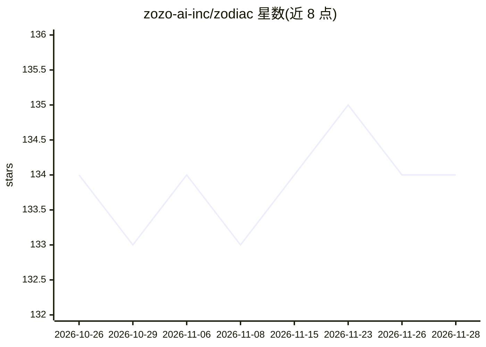

# zozo-ai-inc/zodiac

⭐ 134 · TypeScript · GPL-3.0 · 推送 2026-11-25 · [GitHub](https://github.com/zozo-ai-inc/zodiac) · [官网](https://chat.zozo.sh) · 组织维护

**面向创作者的 AI 角色扮演聊天前端**

由 Zozo AI, Inc. 维护的开源聊天前端（前身为 Zodiac），功能覆盖 AI 对话、自定义人设、角色扮演以及图像生成与编辑。聊天模型经 OpenRouter 接入，可选配置 Gemini API key；图像生成与编辑使用 Runware 托管服务。数据采用浏览器本地优先存储，并提供可选的加密云同步。前端基于 Vite 与 TypeScript 构建，源码以 GPL v3.0 许可发布。

## 筛选速览

| 维度 | 判定 | 备注 |
|---|---|---|
| AI 角色 | `ai-native` | 本体是模型或模型工具 |
| 许可风险 | `viral` | GPL-3.0 |
| 部署形态 | `library` | 以包/库形式分发 |
| 模型依赖 | locked-api |  |
| 硬件要求 | — | 无带数字的原话,不猜 |
| 安装摩擦 | `low` | 无编译、无系统依赖或容器化 |
| 成熟度 | — | 结构信号不足 |

## 能力要点

- AI 对话、自定义人设与角色扮演功能
- 图像生成与编辑（Runway 托管的 Runware 服务）
- 本地优先浏览器存储，可选加密云同步
- 聊天模型经 OpenRouter 接入，可选 Gemini API key

## 适用场景

- 与自定义人设的角色进行对话和角色扮演
- 在聊天中生成和编辑图像
- 本地存储数据的同时按需开启加密云同步

## 场景标签

`聊天机器人` `图像生成` · 领域:对话与助手

## 证据(README 行号)

> L5: Zozo Chat combines AI conversations, customizable personas, roleplay, and image generation and editing. It uses loca
> L11: The frontend is built with Vite and TypeScript. Development happens on `main`; the permanent `production` branch tr

## 星数曲线

2026-10-26 134 → 2026-11-28 134（+0）

---
*卡片 v1 · prompt 1.4 · 生成 2026-11-28 · 置信度 high · 依据 README sha `be4c026a3558` · [字段定义](../../DATASET.md)*
