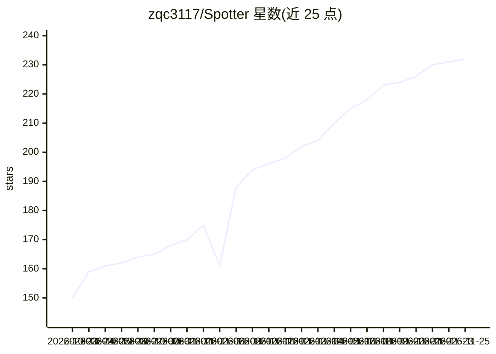

# zqc3117/Spotter

⭐ 232 · Python · MIT · 推送 2026-11-16 · [GitHub](https://github.com/zqc3117/Spotter) · [官网](https://zqc3117.github.io/Spotter/) · 个人维护 · 中文 README

**机器人操作评测框架：VLM 仅在确认错误时介入修复**

论文官方代码库，在冻结的本体策略模型（System 1）与 VLM（System 2）之间加入轻量干预层：本体模型分块持续执行，本地 Qwen 筛查器并行监视，仅当确认错误时由 VLM 判定并修复，无需特权信息（如成功信号）。支持 RoboCasa、RoboTwin 2.0、RoboDojo 三个仿真环境的评测，提供 π0.5 与 Cosmos Policy 检查点下载、逐回合日志记录与一键评测脚本。以多 Python 环境部署，需 vLLM 服务本地模型。

## 筛选速览

| 维度 | 判定 | 备注 |
|---|---|---|
| AI 角色 | `ai-native` | 本体是模型或模型工具 |
| 许可风险 | `permissive` | MIT |
| 部署形态 | `library` | 以包/库形式分发 |
| 模型依赖 | local-ok | 支持本地模型 |
| 硬件要求 | — | 无带数字的原话,不猜 |
| 安装摩擦 | `medium` | 含编译或系统依赖之一 |
| 成熟度 | — | 结构信号不足 |

## 能力要点

- 筛查/判定分层机制：成功回合平均判定调用少于一次，成功回合仅增加 13–16 秒
- 支持三个仿真器（RoboCasa/RoboTwin 2.0/RoboDojo）的一键评测脚本
- 提供 π0.5、Cosmos Policy、Qwen 检查点的下载与本地 vLLM 服务方案
- 可选 GPT 判定器（ENGINE=api），筛查器保持本地 Qwen

## 适用场景

- 复现论文中机器人操作策略的评测结果
- 在仿真环境中为具身模型加入运行时错误监测与修复
- 对比本体模型独立执行与加入监督层的成功率

## 场景标签

`模型评测` · 领域:评测与运维

## 证据(README 行号)

> L21: **Spotter** adds a lightweight intervention layer between a frozen embodied model (System 1) and a VLM (System 2).
> L24: so the whole framework works with a **locally served, open-source Qwen and no privileged information**.
> L31: - [2026/09] 🎉 The paper is on arXiv, and the code is released with the RoboCasa example bank (fewshot_bank.tar.gz).

## 星数曲线

2026-10-23 150 → 2026-11-25 232（+82）

---
*卡片 v1 · prompt 1.4 · 生成 2026-11-25 · 置信度 high · 依据 README sha `b480b6cd8107` · [字段定义](../../DATASET.md)*
