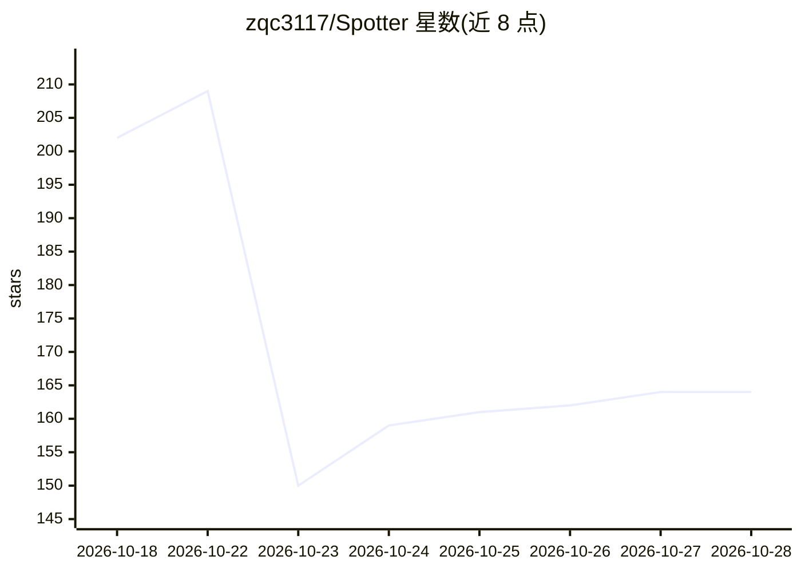

# zqc3117/Spotter

⭐ 164 · Python · MIT · 推送 2026-10-26 · [GitHub](https://github.com/zqc3117/Spotter) · [官网](https://zqc3117.github.io/Spotter/) · 组织维护 · 中文 README

**具身机器人执行监控框架：VLM 仅在确认出错时介入修复**

论文官方代码库。在冻结的具身模型（System 1）与 VLM（System 2）之间加入轻量干预层：具身模型持续执行，本地快速 VLM 并行筛查每个动作块，前沿 VLM 仅在确认错误后介入判定与修复，无需特权信息（如任务成功信号）。支持 RoboCasa 与 RoboTwin 2.0 两个仿真环境，策略模型支持 π0.5 与 Cosmos Policy，判定模型使用本地 vLLM 部署的 Qwen（可选 GPT API）。安装涉及多个 Python 环境、模型 checkpoint 下载与 NVIDIA GPU。

## 筛选速览

| 维度 | 判定 | 备注 |
|---|---|---|
| AI 角色 | `ai-ecosystem` | LLM/agent 周边工具 |
| 许可风险 | `permissive` | MIT |
| 部署形态 | `library` | 以包/库形式分发 |
| 模型依赖 | local-ok | 支持本地模型 |
| 硬件要求 | — | 无带数字的原话,不猜 |
| 安装摩擦 | `medium` | 含编译或系统依赖之一 |
| 成熟度 | — | 结构信号不足 |

## 能力要点

- 具身模型主导执行，VLM 仅在确认错误时介入修复
- 配合本地部署的开源 Qwen，无需特权信息
- 成功回合平均仅增加 13–16 秒，判定器平均调用不足一次
- 支持 RoboCasa 与 RoboTwin 2.0，π0.5 / Cosmos Policy 策略

## 适用场景

- 在仿真环境中监控具身策略执行并自动修复失败动作
- 复现论文中的 RoboCasa / RoboTwin 2.0 评测结果
- 接入自己的具身模型做运行时错误监测

## 场景标签

 · 领域:机器人/具身智能

## 证据(README 行号)

> L22: **Spotter** adds a lightweight intervention layer between a frozen embodied model (System 1) and a VLM (System 2).
> L24: watches in parallel and the VLM steps in only to confirm and repair an error. The VLM's job becomes much simpler,
> L35: - **A lightweight intervention layer.** Like a person who keeps a little attention on a task and focuses only when

## 星数曲线

2026-10-18 202 → 2026-10-28 164（-38）

---
*卡片 v1 · prompt 1.4 · 生成 2026-10-22 · 置信度 high · 依据 README sha `f113c22d3031` · [字段定义](../../DATASET.md)*
