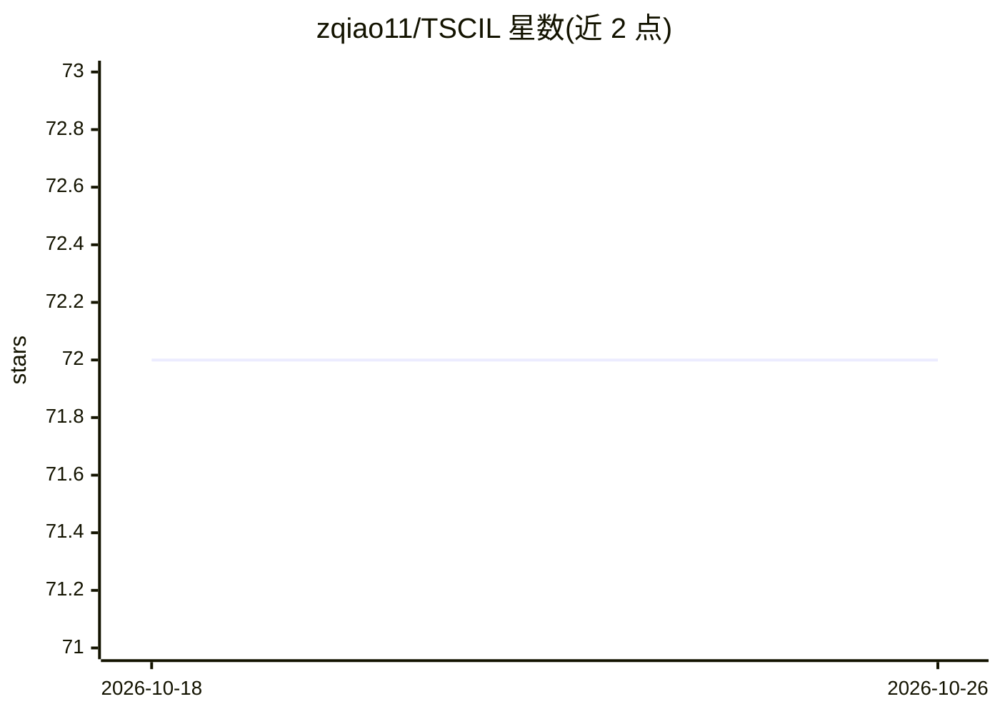

# zqiao11/TSCIL

⭐ 72 · Python · Apache-2.0 · 推送 2026-04-16 · [GitHub](https://github.com/zqiao11/TSCIL) · 组织维护

**时间序列类增量学习的基准与评测框架（KDD 2024）**

基于 PyTorch 的统一实验框架，用于时间序列类增量学习（TSCIL）的基准构建与算法评测。收录 UCI-HAR、UWAVE、WISDM、GrabMyo 等 5 个真实数据集，内置 16 种持续学习算法（正则化与回放两类），支持自定义数据集、任务流与算法扩展。超参搜索基于 Ray Tune，多次运行随机化类序并取平均。提供 Google Drive 下载的预处理数据与论文复现脚本，需在 Conda 环境与 GPU 配置下运行。

## 筛选速览

| 维度 | 判定 | 备注 |
|---|---|---|
| AI 角色 | `ai-ecosystem` | LLM/agent 周边工具 |
| 许可风险 | `permissive` | Apache-2.0 |
| 部署形态 | `None` |  |
| 模型依赖 | — | README 未给出锁定关系 |
| 硬件要求 | — | 无带数字的原话,不猜 |
| 安装摩擦 | `medium` | 含编译或系统依赖之一 |
| 成熟度 | — | 结构信号不足 |

## 能力要点

- 5 个真实世界时间序列数据集的类增量基准
- 内置 LwF/EWC/ER/DER 等 16 种持续学习算法
- 基于 Ray Tune 的超参搜索与多次运行平均评估
- 支持自定义数据集、任务流与新算法（继承 BaseLearner）

## 适用场景

- 时间序列类增量学习算法的统一评测与对比
- 复现 KDD 2024 论文实验结果
- 在自己的时间序列数据上定制持续学习实验设置

## 场景标签

`模型评测` · 领域:评测与运维

## 证据(README 行号)

> L3: A unified experimental framework for Time Series Class-Incremental Learning (TSCIL) based on Pytorch. The paper has 
> L46: ## Continual Learning Algorithms
> L109:  We run the experiment for multiple runs to compute the average performance. In each run, we randomize the class o

## 星数曲线

2026-10-18 72 → 2026-10-26 72（+0）

---
*卡片 v1 · prompt 1.4 · 生成 2026-10-24 · 置信度 high · 依据 README sha `8ab7c19a99a6` · [字段定义](../../DATASET.md)*
