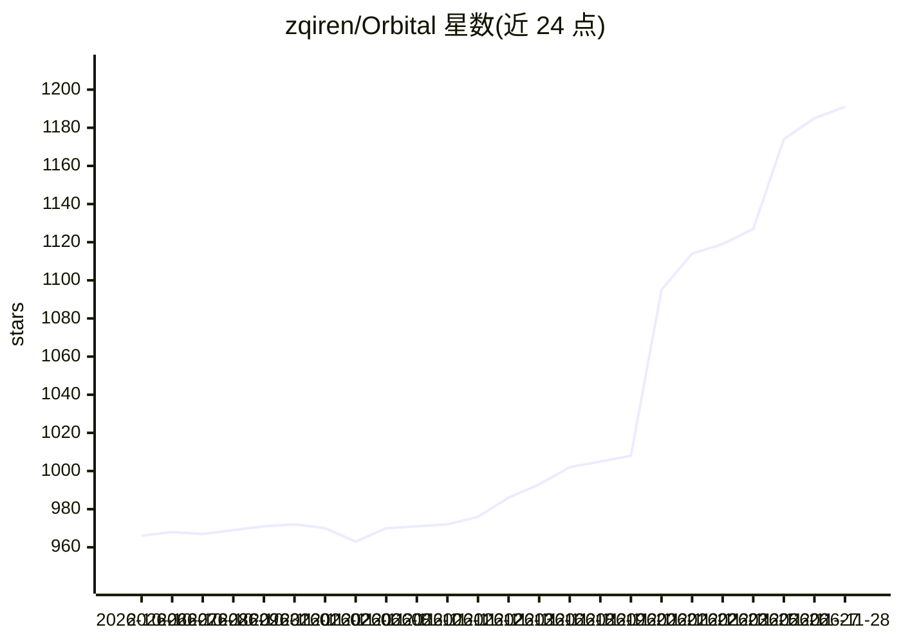

# zqiren/Orbital

⭐ 1,191 · Python · GPL-3.0 · 推送 2026-11-27 · [GitHub](https://github.com/zqiren/Orbital) · [官网](https://orbital.top/) · 个人维护 · 中文 README

**本地项目上下文管家：让多个编码 Agent 共享同一份项目记忆**

Orbital 是一个桌面应用（Windows .exe / macOS .dmg，无需 Python 或 Node），将项目上下文从各 Agent 会话中取出，以本地明文文件维护状态、决策、经验、任务队列与产出五类记录；切换 Claude Code、Codex、Gemini CLI 等 worker 时从同一项目上下文继续。任务队列强制以 Completed/Blocked 结束，支持预算控制、自主级别预设、远程审批与凭据管理（OS keychain）。自带项目 Agent 负责规划与委派，任意 CLI Agent 可经 manifest 注册接入；上下文超 80% 时触发压缩，并有前缀缓存优化。

## 筛选速览

| 维度 | 判定 | 备注 |
|---|---|---|
| AI 角色 | `ai-ecosystem` | LLM/agent 周边工具 |
| 许可风险 | `viral` | GPL-3.0 |
| 部署形态 | `desktop` | 安装包/桌面程序 |
| 模型依赖 | — | README 未给出锁定关系 |
| 硬件要求 | — | 无带数字的原话,不猜 |
| 安装摩擦 | `low` | 无编译、无系统依赖或容器化 |
| 成熟度 | — | 结构信号不足 |

## 能力要点

- 以 PROJECT_STATE.md/DECISIONS.md/LESSONS.md 等本地文件承载跨会话项目上下文
- Agent 用量限额中断后可在 picker 中切换其他 Agent 续接同一对话
- 任务队列强制 Completed/Blocked 收尾，防止排队任务漂移
- 任意 CLI Agent 经 manifest 注册；Claude Code/Codex/Cursor 等预置接入

## 适用场景

- Codex 用量到顶时切换到 Claude Code 继续当前任务
- 多个编码 Agent 在同一项目上协作而不互相重复交代背景
- 需要审批、预算与任务队列治理的多 Agent 项目管理

## 场景标签

`Agent 记忆` `多智能体` `编码 Agent` · 领域:Agent 开发

## 证据(README 行号)

> L14:  Orbital is the context steward for your agents. It maintains your project's context so every agent works from the 
> L58: - **Work** — what is running, completed, or blocked (`queue.json`). Every queued task ends **Completed** or **Block
> L170: Orbital is not tied to a single AI tool. The project agent plans and delegates, while specialized workers execute 

## 星数曲线

2026-10-26 966 → 2026-11-28 1,191（+225）

---
*卡片 v1 · prompt 1.4 · 生成 2026-11-24 · 置信度 mid · 依据 README sha `30171e884fe4` · [字段定义](../../DATASET.md)*
